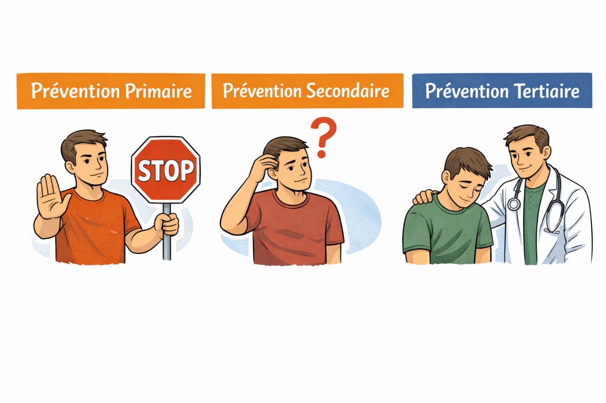

# Introduction

Notre équipe est composée de
quatre membres, chacun avec des formations et des expériences complémentaires.
David, avec une formation de chimie et toxicologie puis une expérience en
gestion des risques apporte une vision croisée. Yannick, professeur de physique,
fournit une perspective scientifique rigoureuse pour aborder les questions
complexes liées à la drogue. Stephane, étudiant en médecine, apporte une
compréhension approfondie des effets physiologiques et des impacts sur la santé
liés à la consommation de drogues. Enfin, Sylvain, spécialiste de la
radioprotection, assure la coordination et la gestion efficace de notre projet.
Ensemble, nous travaillons à fournir un livre informatif et accessible sur le
sujet de la drogue, qui fournira des informations claires et utiles à un large
public.

L’objectif de l’association est
de Promouvoir l'état de l'art scientifique en matière de réduction et gestion
des risques.

Nous avons eu la chance de
pouvoir étudier les drogues et les médicaments grâce à une formation
universitaire en recherche. Nous avons appris à analyser les publications
scientifiques et à rédiger des résumés. Il est important de souligner que de
nombreux chercheurs consacrent leur carrière à l'étude et à la découverte de
nouvelles informations sur les drogues, mais leurs travaux ne sont pas souvent
mis en avant dans les médias.

### Pourquoi

C'est une succession d'événements qui nous a conduits à
écrire un livre et plus précisément un traité. Initialement, nous voulions
uniquement concevoir des fiches de sensibilisation pour nos proches adolescents
et nos enfants. En parallèle, nous nous sommes proposés pour animer des
sessions de sensibilisation aux addictions au travail. Les drogues et les
médicaments nous ont toujours fascinés : le pouvoir qu'une simple molécule peut
avoir sur la personnalité, la santé, le comportement, etc. C'est l'application
de la chimie la plus « puissante » à nos yeux, et pour nous, l'occasion de
joindre l'utile (la prévention) à l'agréable (la science).

Nous avons rapidement réalisé, à travers nos discussions
avec différentes personnes, que la plupart des informations qu'elles nous
donnaient sur les drogues étaient fausses. Nous avons constaté que de
nombreux parents banalisaient l'alcool et se trouvaient démunis face à
l'ecstasy ; que des jeunes considéraient le cannabis moins toxique que le
tabac, ou des trentenaires persuadés qu'un verre de vin par jour est bon pour
la santé, etc.

Nous avons continué nos recherches, ressorti nos cours et
nous sommes rapidement rendu compte que les personnes souhaitant avoir une consommation
responsable sont confrontées à un parcours du combattant . Il faut faire
face à une montagne de sources d'informations (livres, articles, forums, etc.)
qui sont, soit trop techniques, soit trop vulgarisées et très dispersées. Les
notions sont parfois mal interprétées et les témoignages tronqués ou focalisés
sur une drogue en particulier.

Les associations de prévention doivent, avec leurs faibles
moyens, atteindre le maximum de personnes en un minimum de temps.
Malheureusement, il est très difficile de traiter la question dans le détail
dans ces conditions.

Or, nous pensons qu'il faut donner l’opportunité à chacun,
via les clés scientifiques de base pour comprendre et ancrer les règles pour
réduire les risques. Car sans comprendre ce que les drogues induisent dans le
corps, les décisions se basent rapidement sur les « on dit » ; des croyances
qui vont engendrer des risques d'erreurs et de potentielles conséquences sur la
santé physique ou mentale.

L'idée s'est véritablement concrétisée lors d'une soirée
avec des jeunes qui avaient la vingtaine. Savoir à quoi nous nous exposons lors
d'une consommation peut éviter des comportements problématiques, et nous
aurions aimé avoir les informations présentées dans ce livre durant notre
jeunesse. Si nous ne pouvons pas refaire le monde, nous pouvons (peut-être)
aider les jeunes (y compris nos enfants) et leurs familles à mieux comprendre
et aborder une facette de ce qui cristallise à l'adolescence la découverte de
soi, la recherche de nouvelles sensations et le goût du risque : les drogues.

En parallèle, il y a une évolution des consommations, passée
sous silence, comme un tabou. Des drogues consommées par certaines classes
sociales, comme la cocaïne qui était réservée à une élite, le GHB dans les
soirées festives parisiennes ou le crack qui est un signe de marginalisation,
sont aujourd'hui consommées par toutes les classes sociales. Certains médias «
main stream » présentent les psychédéliques comme des remèdes miracles sans
rentrer dans les détails : le LSD pour traiter les addictions, la MDMA
(l'ecstasy) pour traiter le stress post-traumatique, ainsi que la psilocybine
(champignon hallucinogène) pour traiter les dépressions, etc. Si notre cible
était à l'origine les jeunes adultes, nos recherches nous ont démontré que tous
les consommateurs sont concernés.

Si ce livre peut aider, ne serait-ce qu'une personne, à
comprendre et à ne plus ou pas dépendre, alors notre objectif sera atteint. En
tant qu'association RISKY, nous souhaitons contribuer à une meilleure
compréhension des drogues et des médicaments, et aider les gens à prendre des
décisions éclairées pour protéger leur santé physique et mentale.

### Objectif

Ce livre s’adresse à toute
personne qui souhaite comprendre comment diminuer les risques et comprendre les
bases qui y sont associées : de l’étudiant en pharmacie ou médecine aux
proches de personnes addict en passant par tous les types de consommateurs,
régulier ou occasionnel.

D’un point de vue stratégique,
trois types de prévention sont possibles :

– La prévention primaire, qui a pour objectif d’éviter toute
consommation de drogues

– La prévention secondaire, qui a pour but de réduire
les risques encourus par les consommateurs

– La prévention tertiaire, qui a pour but de réduire
les conséquences de l’addiction.

Ce livre s’intègre dans la prévention secondaire :
mieux maitriser les risques.

Actuellement, les actions de prévention se concentrent
majoritairement sur la prévention primaire, visant à empêcher toute première
consommation, et sur la prévention tertiaire, centrée sur la prise en charge
des personnes présentant un trouble de l’usage. Or, comme cela sera détaillé
dans cet ouvrage , la majorité des consommateurs, toutes substances
confondues, relèvent d’un usage simple. Autrement dit, une consommation
existe, mais sans répondre aux critères diagnostiques d’un trouble de l’usage
selon les classifications médicales actuelles (voir le chapitre « Accro dès la
première prise » dans la partie « Mythes et addiction »).

<figure class="doc-figure">
  
  <figcaption>Distinction entre prévention primaire, prévention secondaire et prévention tertiaire.</figcaption>
</figure>

Ces usagers ne se reconnaissent ni dans la prévention
primaire, souvent fondée sur des messages dissuasifs visant l’abstinence, ni
dans la prévention tertiaire, puisqu’aucune pathologie addictive constituée
n’est présente. De ce fait, une large proportion de consommateurs se retrouve
sans cadre structuré d’information, s’appuyant principalement sur des croyances
personnelles, des conseils informels circulant entre pairs, ou, dans le
meilleur des cas, sur des messages de réduction des risques transmis de manière
fragmentaire par certaines associations. Il existe donc un manque d’outils
pédagogiques accessibles permettant d’expliquer de façon détaillée,
scientifique et contextualisée les mécanismes d’action des substances, leurs
effets et les risques associés aux usages.

L’idée n’est pas moraliser mais de comprendre les risques et
comment s’en protéger

L'objectif est de fournir des informations claires,
précises, vérifiables et surtout factuelles sur les effets et les risques des
drogues, sans prétendre à l'exhaustivité. Nous ne portons aucun jugement de
valeur, nous nous attachons uniquement à présenter les faits.

Chaque sujet traité pourrait faire l'objet d'un livre
entier, mais notre intention n'est pas de vous transformer en expert ou en
addictologue. Notre ambition, en tant que l'association RISKY, est de vous
armer des connaissances de base nécessaires pour favoriser une prise de
conscience des dangers liés à l'usage des drogues, afin de vous aider à prendre
des décisions éclairées et responsables.

De nombreux préjugés sur les drogues, souvent erronés, sont
ancrés dans la société par les médias. L'exemple typique est l'idée répandue selon
laquelle consommation modérée d'alcool est bénéfique pour la santé, qui
illustre la loi de Brandolini (ou loi du bullshit): il est bien plus
facile de propager une idée fausse que de rétablir la vérité. La correction de
ces idées fausses est ardue. Elle requiert une sensibilisation du public,
l'apport de preuves crédibles et la résistance au sensationnalisme.

C'est là l’un des défis de ce livre : Avoir une approche
scientifique et qui permettra de déconstruire des croyances erronées, en
fournissant des informations précises et accessibles sur les risques associés à
sa consommation.

L'objectif est d'instaurer une culture de prévention
basée sur une vision scientifiquement rigoureuse et les avancées récentes de la
recherche .

A qui
s’adresse le livre

Dans le paysage complexe de la consommation de substances,
une multitude d'acteurs jouent des rôles divers, chacun avec des objectifs
distincts. Le présent ouvrage s'adresse à eux, proposant des perspectives et
des outils adaptés à leurs missions respectives.

Pour le consommateur et son entourage , qui sont
directement concernés par les risques, ce guide offre des ressources pour
comprendre et gérer les dangers liés à la consommation de drogues. Il vise à
éduquer sur les mesures de réduction des risques, fournissant ainsi une aide
directe.

Les associations spécialisées dans la réduction des
risques (telles que les CARRUD, CSAPA) et les travailleurs sociaux . Leur
objectif est de diminuer les risques lors des consommations, et de les
prévenir. Elles soutiennent les consommateurs sur le terrain, trouveront dans
cet ouvrage un appui pour leur travail. Grâce à leur proximité avec les
usagers, ces professionnels ont une connaissance approfondie des effets des
substances et une expérience dans la gestion des situations à risque. Ce livre
leur sert de support pour la formation continue, de référence pour la création
de supports de communication et renforce leurs compétences en prévention et
intervention.

Les cliniciens (addictologues, médecins généralistes,
psychiatres, etc.), leur objectif est de diagnostiquer traiter les
addictions et les conséquences des consommations. Ils découvriront dans ce
livre une ressource pour compléter leur formation initiale. En abordant de
manière accessible les aspects médicaux et psychologiques de l'accompagnement,
cet ouvrage aide les professionnels de santé à enrichir leur approche clinique
et à actualiser leurs connaissances par rapport à l’état de l’art.

Pour les scientifiques , leur objectif est d’améliorer
les connaissances scientifiques sur les drogues dans tous les domaines. Ce
livre offre un aperçu des connaissances globale sur les substances, favorisant
le lien entre la recherche et les pratiques de terrain en matière de réduction
des risques.

Pour les journalistes , ce livre est une source
d'inspiration pour leurs articles et reportages, leur offrant des informations
pour aborder avec précision les sujets liés à la consommation de drogues. Il
leur permet d'accéder à des données à jour et à des analyses sur les politiques
de réduction des risques et les débats sociétaux, contribuant à une information
précise du public. Ce faisant, les journalistes peuvent contribuer à la
déstigmatisation des consommateurs et à la diffusion de pratiques informées par
la recherche, soutenant une approche plus équilibrée de la question des drogues
dans la société.

Comment
lire ce livre ?

Nous trouvons cela frustrant de lire trois pages pour une
idée qui peut se résumer en deux lignes. Nous avons donc fait de notre mieux
pour aller droit au but et faire passer le message de manière très fluide et
précise : « less is more » comme disent les Américains.

Nous vous proposons différentes approches pour appréhender
ce livre et en tirer un maximum d'information en fonction de vos contraintes et
qui s'adapte à votre motivation

| Motivation | Je veux comprendre grossièrement les éléments importants.   Je veux uniquement réduire les risques de ma consommation | Je veux comprendre les notions et me faire mon propre   avis. | Je veux pouvoir argumenter et débattre. Je veux expliquer   ou sensibiliser d’autres personnes. |
| --- | --- | --- | --- |
| Conseil de lecture | Lisez uniquement les encadrés | Lisez les titres VIOLETS | Lisez les parties 1 et 2 a minima |
| Durée approximative de lecture | 30 minutes   Soit 1/3 du temps passé sur Instagram   sur une journée [[1]](/references#ref-1)   ou environ le temps passé sur le trône par homme en une journée [[2]](/references#ref-2) … | Entre 2 et 3h | 5h |

Ce livre comporte donc beaucoup de sous-chapitres pour
rapidement identifier les parties qui sont plus facultative et les références
sont directement en bas de page pour éviter de chercher à la fin du livre.

Il est composé de trois grandes parties :

→ La
première explique le fonctionnement des drogue et médicament su le cerveau :

→ La
deuxième permet de découvrir les drogues selon leur classement et leur
dangerosité

→ La
troisième aborde les risques communs à toute prise de drogue et permet d’identifier
des règles de réduction des risques qui sont communes

Pour une lecture efficace :

– il
est nécessaire de mettre de côté ce que vous croyez savoir sur les drogues,

– certaines notions peuvent
être difficile.

Si vous restez bloqué sur une de vos croyances, n’hésitez
pas à compléter les recherches et à consulter les sources citées dans le livre.

### Aspect scientifique

Nous avons fait en sorte de simplifier et de vulgariser au
maximum les phénomènes biologiques et chimiques liés aux drogues que nous
décrivons dans ce livre, mais nous les expliquons tout de même
systématiquement.

Par ailleurs, afin de renforcer
la validité scientifique et vous adresser les éléments les plus justes tout en
étant vulgarisés, nous avons fait relire ce livre par des professionnels de
santé, que nous remercions d'ailleurs pour leur temps et conseils.

Dans
une première approche, toute substance psychoactive (active sur le cerveau)
pris en automédication ou de façon récréative sera considérée comme drogue.

### Sources

Si vous souhaitez obtenir une
perspective plus précise et approfondie, nous vous recommandons de consulter
les sources mentionnées dans ce livre. Nous avons veillé à exclure les ouvrages
coûteux et les publications scientifiques inaccessibles afin de vous permettre
d'accéder à une grande variété de contenus gratuits basés sur ces livres et
études, et si possible, divertissants (y compris des vidéos).

De plus, nous avons largement
tiré parti des ressources fournies par différentes associations (la principale
étant l'association suisse Nuit Blanche [[3]](/references#ref-3) ).
Nous tenons à les remercier pour leur travail acharné, leur disponibilité et
les débats enrichissants et captivants qui ont lieu presque quotidiennement.

Cadre
juridique

Légalement, la facilitation ou la provocation à l'usage
sont interdites (par l'article L.3421-4 du code de la santé publique). Il
est également interdit de présenter les produits classés comme stupéfiants
sous un jour favorable (aucun problème, autre que moral, pour l'alcool et
le tabac).

Cependant, la réduction des risques (RdR) vise à informer
les consommateurs de drogues, à les responsabiliser et à les aider dans leur
pratique. Alors, est-ce que fournir une seringue propre ou un filtre à un
consommateur d'héroïne constitue une facilitation à l'usage ? Est-ce qu'une
association distribuant des flyers expliquant les risques liés à la MDMA, tout
en mentionnant également ses effets, est sujette à une provocation à l'usage ou
à la présentation d'un stupéfiant sous un jour favorable ?

L'histoire de la réduction des risques, ou réduction des
risques et des dommages, a commencé par des combats menés par des associations,
mais également par des autorités et ministres de la santé.

Pour comprendre le cadre juridique de ce livre, il est intéressant
de saisir l'objectif des associations de réduction des risques (RdR).

L'objectif des associations de réduction des risques (RdR)
est d'atténuer les dangers sanitaires, sociaux et la mortalité liée à la
consommation de substances psychoactives. La RdR, apparue il y a 30 ans, prône
la responsabilité individuelle et collective, la promotion de la santé et
l'éducation sanitaire. Elle englobe les actions et politiques de santé publique
concernant toutes substances et types d'usages, sans imposer l'abstinence.

Voici les principes clefs de l'association Energy Control [[4]](/references#ref-4)
(intégrée à l'association ABD, partiellement financée par l'État) qui montre la
traduction opérationnelle de cet objectif. Toutes les associations n'adhèrent
pas strictement à ces mêmes points, mais cela facilite la compréhension de leur
approche. Energy Control traite la réduction des risques en se référant à la «
gestion des risques et des plaisirs », avec les 8 éléments clés suivants :

1.
 La consommation de drogues est et restera une réalité : il y aura
toujours des personnes qui souhaiteront utiliser des drogues légales et
illégales malgré les efforts de prévention et/ou de répression visant à
l'empêcher.

2.
 Il existe différentes motivations pour l'utilisation de drogues, ainsi
que différentes formes de consommation présentant des niveaux de risque
différents. Le risque est multifactoriel.

3.
 Il y a un plaisir associé à l'utilisation de drogues, reconnu et
recherché par ceux qui les utilisent, mais systématiquement nié par les
approches d'abstinence ou de prohibition.

4.
 Prendre des drogues ne signifie pas nécessairement avoir des problèmes.
Penser que les gens se tournent vers les drogues parce qu'ils sont vulnérables
perpétue la stigmatisation.

5.
 L'addiction n'est pas le seul problème associé aux drogues . Dans
la plupart des cas, les problèmes sont aigus et ne nécessitent pas
l'établissement d'une dépendance.

6.
 Une consommation responsable de drogues est possible, tout comme une
pratique responsable d'autres activités risquées est possible.

7.
 Des informations objectives et utiles sur les substances, les
risques et les modèles de consommation à moindre risque sont une condition
nécessaire, mais pas suffisante, pour faciliter une prise de décision éclairée.

8.
 Les efforts tendent à se concentrer sur la prévention de
l'utilisation et le traitement des personnes qui ont développé des problèmes
liés à leurs consommations, laissant ainsi sans aide la majorité des
personnes qui utilisent des drogues de manière récréative, qui ne rencontrent
pas de problèmes, mais qui sont à risque de les rencontrer.

Pour faire accepter le principe de la réduction des risques
et l'existence même des associations ayant cet objectif, le procès de
l'association Techno+ [[5]](/references#ref-5)
qui était pionnière de la RdR en milieu festif a été déterminant. En effet,
celui-ci était un affrontement entre la politique de réduction des risques liée
à la consommation de drogues et le ministère de l'Intérieur qui s'y opposait
depuis longtemps. Moins célèbre et plus vulnérable que d'autres organisations
luttant pour les mêmes causes, comme AIDES ou Médecins du Monde [[6]](/references#ref-6)
(qui sont les premiers à avoir fait de la réduction des risques), attaquer
Techno+ permettait de remettre en question ces politiques sans cibler des
acteurs plus en vue.

Après un premier procès remporté en 2003 pour un vice de
procédure, l'État fit appel pour juger l'affaire sur le fond. Durant la période
du procès, Techno+ et ses soutiens, notamment l'Association Française pour la
Réduction des Risques liés aux Usages de Drogues, réussirent à faire inscrire
la protection juridique des intervenants des associations. Ensuite, un décret
référentiel des actions de réduction des risques pour les usagers de drogues
fut publié le 14 avril 2005. Le 18 avril 2005, Techno+ fut relaxée de toutes
les charges d'accusation d'incitation et de facilitation à l'usage de drogues.
Depuis lors, les conseils de consommation de drogues à moindre risque, pour
lesquels Techno+ avait été accusée, font désormais partie des recommandations
sanitaires.

Voici un extrait de l'article L3411-8 qui cadre les actions
de réduction des risques et qui concerne ce livre :

« I. - La politique de réduction des risques et des
dommages en direction des usagers de drogue vise à prévenir les dommages
sanitaires, psychologiques et sociaux, la transmission des infections et la
mortalité par surdose liés à la consommation de substances psychoactives ou
classées comme stupéfiants.

II. - Sa mise en œuvre comprend et permet les actions
visant à :

1° Délivrer des informations sur les risques et
les dommages associés à la consommation de substances psychoactives ou classées
comme stupéfiants ;

2° Orienter les usagers de drogue vers les
services sociaux et les services de soins généraux ou de soins spécialisés,
afin de mettre en œuvre un parcours de santé adapté à leur situation spécifique
et d'améliorer leur état de santé physique et psychique et leur insertion sociale
;

5° Participer à l'analyse, à la veille et à
l'information, à destination des pouvoirs publics et des usagers, sur la
composition, sur les usages en matière de transformation et de consommation et
sur la dangerosité des substances consommées.

III. - L'intervenant agissant conformément à sa mission
de réduction des risques et des dommages bénéficie, à ce titre, de la
protection mentionnée à l'article 122-4 du code pénal. »

La réduction des risques est de plus en plus acceptée, bien
que du chemin reste à parcourir pour faire évoluer les mentalités et les
préjugés.

Enfin, une avancée importante à eu lieu en Mars 2024. La
commission de l'ONU sur les stupéfiants vient de reconnaître pour la première
fois la Réduction des Risques (RDR) comme un élément essentiel de santé
publique en lien avec la consommation de produits psychotropes hors cadre
médical. La résolution a été votée le 22 mars par 70% des 53 membres, avec
comme unique opposant la Russie et de la Chine. Elle encourage les États à
soutenir et financer les démarches de RDR, et à "réduire toute
discrimination, exclusion ou atteintes" à l'égard des usagers de
stupéfiants [[7]](/references#ref-7) .

Ce livre est écrit dans le
seul but d'informer
et de réduire les risques liés à la consommation de certaines substances.

Certains produits abordés
dans ce livre sont illégaux. Il est de votre responsabilité de respecter la
loi.

Nous n'encourageons
personne à consommer des drogues, et nous ne pourrions être tenus pour
responsables si vous le faites.

Les résumés sur les
pratiques de réduction des risques sont issus d'échanges avec des
consommateurs, des associations et surtout des publications scientifiques. Ce
ne sont pas des prescriptions qui vous éviteront de façon certaine des
problèmes, et nous ne pourrions être tenus pour responsables de vos actes.

En tant qu'association RISKY, notre
mission est de vous informer et de vous aider à mieux comprendre les enjeux
liés à la consommation de drogues et de médicaments. Nous vous invitons à
utiliser ces informations avec discernement et à toujours respecter les lois en
vigueur.
