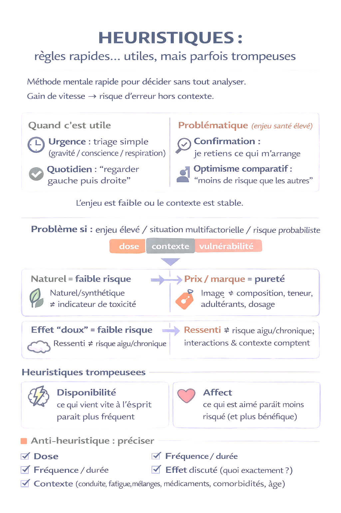
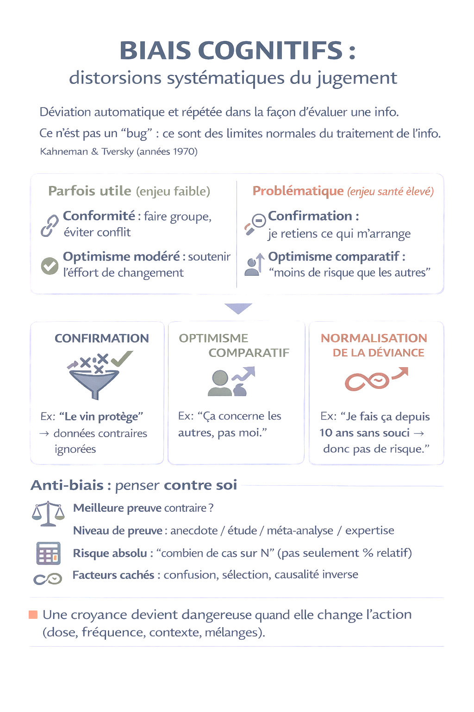
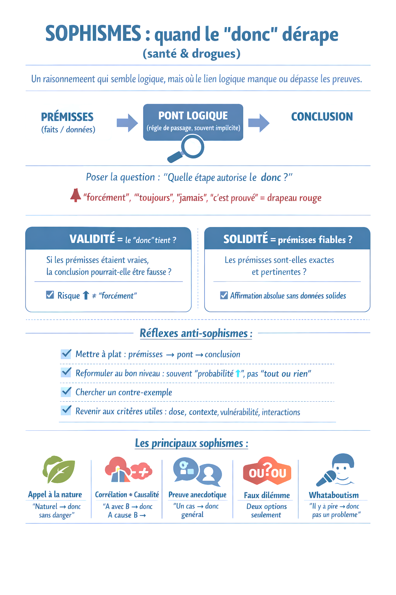

# Mythes, croyances, heuristiques, biais et sophismes

Pour aborder les risques liés aux substances psychoactives
de manière plus objective et dépassionnée, il est indispensable de déconstruire
certains mythes profondément ancrés dans les croyances populaires. Ces idées
reçues, souvent basées sur des approximations ou des interprétations erronées,
freinent ou bloquent l'accès à une compréhension rigoureuse et scientifique des
sujets abordés.

Prenons quelques exemples pour illustrer ces interprétations
et leurs conséquences :

- L'idée qu'une personne ayant consommé du LSD pourrait en
"contaminer" une autre en l'embrassant. Cette croyance erronée
entrave l'apprentissage des mécanismes biologiques liés au métabolisme des
drogues, notamment leur absorption, leur transformation et leur élimination par
l'organisme. Elle détourne également l'attention des véritables interactions
entre ces substances et les récepteurs neuronaux. Cela peut amener un lecteur à
mal interpréter les informations sur la transmission des substances ou sur leur
fonctionnement réel dans le corps humain.

- La conviction qu'un verre de vin par jour est bénéfique pour
la santé. Bien que cette idée soit souvent relayée dans les médias, elle
conduit à des biais d'interprétation des données toxicologiques, en particulier
sur la notion de dose-réponse. Un lecteur adhérant à cette croyance pourrait
chercher à sélectionner ou à interpréter des faits qui confirment son point de
vue, tout en ignorant les preuves qui montrent que même une consommation
modérée d’alcool peut augmenter certains risques pour la santé, comme ceux liés
aux maladies cardiovasculaires ou au cancer.

- La croyance qu’un produit naturel est intrinsèquement meilleur
qu’un produit synthétique. Cette idée fausse pousse à une sous-évaluation
des risques liés aux substances naturelles et à une surestimation de ceux
associés aux substances synthétiques. Par exemple, un lecteur influencé par ce
biais pourrait considérer le cannabis ou les champignons hallucinogènes comme
inoffensifs uniquement parce qu’ils sont naturels, et se montrer excessivement
méfiant envers des substances synthétiques bien étudiées, comme certains
médicaments ou psychotropes. Cette attitude risque de perturber la compréhension
des classifications des substances, qui reposent sur des critères objectifs
(toxicité, potentiel d’abus, usages médicaux) et non sur leur origine.

- La perception du GHB uniquement comme une "drogue du
viol". Une vision réductrice comme celle-ci empêche d’appréhender les
multiples facettes de cette substance. Un lecteur pourrait alors ignorer ses
usages légitimes en médecine, comme dans le traitement de la narcolepsie, et se
focaliser exclusivement sur des scénarios liés à des comportements
malveillants. Ce biais peut nuire à une analyse équilibrée des différentes
substances utilisées dans un contexte de sexualité ou de vulnérabilité.

Ces mythes agissent comme des filtres cognitifs qui
déforment la perception des drogues, de leurs effets et de leurs implications.
Ils peuvent conduire à des erreurs d’interprétation qui biaisent non seulement
la réflexion, mais aussi l’évaluation des informations scientifiques
présentées.

Briser ces mythes est nécessaire pour permettre d’aborder
le sujet des drogues de façon dépassionnée. En clarifiant ces idées
préconçues, il devient possible d’aborder les sujets complexes liés aux
substances psychoactives avec une perspective fondée sur les faits, favorisant
ainsi une meilleure compréhension et prise de décision éclairée.

Cette partie commence par un premier chapitre consacré aux mécanismes
psychologiques qui favorisent les fausses croyances, ainsi qu’une partie pour
poser les bases de ce qu’est la science . Ensuite, plusieurs mythes seront
abordés :

**Croyances et risques**

Les croyances factuellement
erronées [[8]](/references#ref-8)
ne se forment pas uniquement au hasard : elles s’appuient souvent sur des
mécanismes psychologiques et cognitifs classiquement décrits.

Quatre familles seront utilisées
ici comme grille de lecture opérationnelle :

•
 Heuristiques : raisonnements rapides utilisés pour décider sans
analyse exhaustive.

•
 Biais cognitifs : distorsions systématiques du jugement liées au
fonctionnement ordinaire du cerveau.

•
 Sophismes : erreurs d’argumentation fondées sur des structures
logiques invalides.

•
 Mécanismes de protection psychologique : dissonance cognitive,
raisonnement motivé, protection de l’identité, réactance.

Dans la vie quotidienne, de
nombreuses décisions doivent être prises rapidement. Afin de limiter le coût
cognitif — en temps, en attention et en énergie — des raccourcis mentaux sont
mobilisés. Dans des situations à faible enjeu, ces mécanismes peuvent être
efficaces ; ils deviennent moins fiables lorsque l’enjeu est élevé, lorsque le
risque est complexe, probabiliste et différé, ou lorsque le sujet est
socialement chargé.

Toutes les croyances inexactes ne
deviennent pas problématiques. Elles le deviennent lorsqu’une décision est
orientée et qu’une action défavorable à la santé, à la sécurité ou au bien-être
est facilitée.

Ces croyances seront qualifiées
ici d’ actionnelles , lorsqu’elles modifient effectivement la conduite.
Concrètement, une croyance actionnelle peut modifier la probabilité de
consommer, la dose ou la fréquence, le choix du contexte (conduite, mélanges,
isolement, fatigue) ou l’adoption — ou l’abandon — de mesures de réduction des
risques.

Dans le cas des drogues, la
difficulté est amplifiée : le sujet n’est pas seulement informatif. Des
dimensions culturelles et sociales, ainsi que des normes implicites, y sont
associées. Une croyance peut alors être un marqueur de statut, d’appartenance,
ou de valeur.

Dans ces conditions, une
correction n’est pas toujours reçue comme une mise à jour factuelle mais comme
une menace pour l’image de soi, et les arguments peuvent être évalués moins
sur leur solidité factuelle que sur leur compatibilité psychologique avec
l’individu.

Afin de mieux comprendre comment
se forment ces croyances et d’identifier les principales résistances, ce
chapitre présente les grandes familles de mécanismes, illustrées d’exemples,
ainsi que des pistes pour en limiter les effets. Enfin, une méthode pratique en
six questions est proposée pour corriger une croyance de manière factuelle et
psychologiquement acceptable.

## Création des croyances

### Heuristique

Une heuristique [[9]](/references#ref-9)
correspond à une méthode mentale rapide [[10]](/references#ref-10) ,
utilisée pour décider ou résoudre un problème sans examiner exhaustivement
toutes les informations disponibles. Des règles pratiques issues de
l’expérience sont mobilisées : un gain d’efficacité est obtenu, au prix d’un risque
d’erreur lorsque la règle est appliquée hors de son domaine de validité .

Des exemples “utiles” sont observés quand une décision doit
être prise vite, avec peu de données :

Une heuristique n’est pas une erreur en soi mais peut
devenir problématique lorsque l’enjeu est élevé, lorsque la situation est
multifactorielle, ou lorsque le risque est probabiliste et/ou différé.

#### Heuristiques problématiques : exemples

La différence entre Sophisme et heuristique réside dans
l’utilisation de la formule :

Pour éviter la confusion, les exemples suivants sont abordés
comme heuristique :

Disponibilité et affect : deux heuristiques majeures dans
la perception du risque

Deux heuristiques documentées en psychologie du jugement
contribuent fortement à la perception du danger :

#### Comment limiter l’erreur

Lorsque le raisonnement est dominé par une heuristique, il
faut essayer de préciser le sujet.

Une règle simple peut être retenue : lorsqu’une phrase
sur une drogue ne contient ni dose, ni fréquence, ni effet, une évaluation
n’est pas présente ; une impression de bon sens est présente.

<figure class="doc-figure">
  
  <figcaption>Les heuristiques peuvent aider dans des situations simples, mais tromper quand le risque dépend de plusieurs facteurs.</figcaption>
</figure>

### Biais

Un biais cognitif correspond à une déviation systématique
dans la manière dont une information est perçue, interprétée ou évaluée.
Contrairement aux heuristiques, qui sont des stratégies de simplification, les
biais décrivent des distorsions récurrentes du jugement, souvent automatiques
et non intentionnelles, influencées par les attentes, les croyances préexistantes,
les émotions et le contexte social.

Le terme biais cognitif a été introduit au
début des années 1970 par Daniel Kahneman [[13]](/references#ref-13)
et Amos Tversky, précisément pour expliquer pourquoi l’esprit humain s’écarte
parfois de la rationalité attendue. Depuis, des
dizaines de biais ont été documentés en psychologie cognitive et sociale [[14]](/references#ref-14) .
Ils ne traduisent pas un dysfonctionnement du cerveau, mais plutôt les
limites de notre traitement de l’information . En situation complexe, ces
raccourcis mentaux aboutissent à des jugements systématiquement orientés dans
le même sens – d’où le terme de distorsion systématique .

#### Biais parfois “fonctionnels” : exemples

En revanche, lorsque l’optimisme
devient irréaliste, une sous-estimation du risque personnel peut être produite [[17]](/references#ref-17) .

#### Biais parfois problématiques : exemples

•
 Biais de confirmation

o
 Une sélection asymétrique des preuves est observée : les
informations compatibles avec la croyance sont jugées plus convaincantes, et
les informations contraires sont minimisées ou disqualifiées. Ce phénomène a
été décrit comme transversal et très fréquent [[18]](/references#ref-18) .

§
 Exemple : la croyance “le vin protège le cœur” tend à être
entretenue par la mémorisation d’études ou d’articles allant dans ce sens,
tandis que les données sur la cancérogénicité de l’alcool ou sur les biais des
études (confusion, classification des abstinents, etc.) tendent à être
ignorées. Une formulation prudente est préférable : un bénéfice
cardiovasculaire a été discuté historiquement, mais l’évaluation globale des
risques reste défavorable, et l’absence de “niveau sans effet” sur la santé a
été rappelée par l’OMS Europe.

•
 Optimisme comparatif

o
 Un risque personnel est estimé inférieur à celui des autres : “ça
concerne surtout les gens qui dérapent, pas moi”. Ce biais a été synthétisé
dans la littérature comme un mécanisme récurrent de jugement du risque [[19]](/references#ref-19) .

§
 Exemple : “je bois régulièrement mais je contrôle”, “je ne
suis pas concerné par la dépendance”, ou “je conduis très bien même après deux
verres”. Une prise de précaution peut alors être retardée (pauses, réduction,
évitement conduite, dépistage, consultation).

- Normalisation de la déviance (illusion de sécurité par
répétition sans incident)

o
 Une pratique initialement perçue comme limite peut devenir
“normale” parce qu’aucun événement grave n’est survenu jusque-là : l’absence
d’incident est interprétée comme une validation. Ce mécanisme a été
conceptualisé par Vaughan et étudié par exemple à la NASA ou dans les
organisations criminelles [[20]](/references#ref-20)

§
 Exemple : “je bois depuis 10 ans et je n’ai ‘rien’ →
donc pas de risque”. Or une partie des dommages est probabiliste, cumulative et
différée (ex. cancers), ce qui rend l’argument “pas d’incident = pas de risque”
non valide.

#### Comment limiter l’erreur

La parade tient en un mot : la contradiction .
Il faut consciemment aller à l’encontre du biais en cherchant le point
de vue opposé :

En résumé, contrer les biais demande un effort volontaire
de «  penser contre soi-même  » , en examinant
honnêtement la thèse opposée avec le même niveau d’exigence. Cet effort
critique permet de rétablir un jugement plus équilibré.

<figure class="doc-figure">
  
  <figcaption>Les biais deviennent problématiques lorsqu'ils influencent une décision de santé ou de réduction des risques.</figcaption>
</figure>

### Sophisme

Un sophisme peut être défini
comme un raisonnement fallacieux qui donne l’apparence d’une
argumentation valide, alors qu’un lien logique manque, qu’un saut implicite est
effectué, ou qu’un critère non pertinent est utilisé à la place du critère
utile. Il ne s’agit plus ici de raccourcis mentaux (comme pour les
heuristiques) ni de distorsions du jugement (comme pour les biais), mais d’ arguments
qui produisent une illusion de cohérence .

Certains sophismes sont utilisés
sciemment pour manipuler l’auditoire, d’autres sont commis de bonne foi par
ignorance des règles logiques. Dans tous les cas, ils peuvent renforcer des
croyances fausses en donnant un vernis de rationalité à un
discours irrationnel.

Les sophismes classiques ont été
étudiés depuis l’Antiquité (Aristote [[22]](/references#ref-22)
a commencé à les décrire). La recherche contemporaine en logique
informelle , portée notamment par Douglas Walton [[23]](/references#ref-23)
et d’autres, a élargi et affiné cette classification. Aujourd’hui il est
considéré qu’un même argument peut être fallacieux dans un contexte et valide
dans un autre, selon les règles du dialogue en cours. Néanmoins, pour
simplifier, il est possible de se focaliser sur quelques formes
courantes de sophismes fréquentes dans le domaine des drogues et des
discours sur la santé.

#### Bases de la logique

Dans les discussions sur la santé et les drogues, une
vigilance particulière doit être appliquée lorsque des mots comme « donc », «
c’est la preuve que », « forcément », « jamais », « toujours » sont utilisés :
une certitude peut être affichée alors que la démonstration manque.

Pour qu’un raisonnement soit correct, trois éléments doivent
être présents et correctement reliés :

##### Exemple simple (raisonnement correct vs fallacieux)

**Raisonnement cohérent**

Raisonnement fallacieux (preuve anecdotique /
généralisation)

##### Validité et solidité : deux façons de se tromper

Deux questions suffisent pour analyser un argument :

- Validité [[25]](/references#ref-25)
(Conclusion douteuse): le “donc” est-il justifié ? Autrement dit, si les
prémisses étaient vraies, la conclusion pourrait-elle quand même être fausse ?

- Solidité [[26]](/references#ref-26)
(Prémisses douteuses): les prémisses sont-elles exactes et pertinentes ? Un
raisonnement peut être valide tout en restant faux si une prémisse est fausse.

Exemple de raisonnement non valide (le “donc”
dépasse les prémisses)

Un passage a été effectué d’un constat probabiliste
(“risque augmenté dans une population”) à une conclusion déterministe (“forcément”).
Même si la prémisse était vraie, la conclusion pourrait être fausse : une
personne peut ne pas avoir d’accident, ou conduire correctement dans un cas
donné. Le “donc” dépasse ce que les prémisses autorisent.

En santé publique et en
toxicologie, une difficulté supplémentaire doit être gardée en tête : le
raisonnement est souvent défaisable (probabiliste). Une conclusion est
alors soutenue par des prémisses, sans être garantie à 100 % ; elle peut
être renversée ou nuancée par une information nouvelle (dose, contexte,
vulnérabilité, polyconsommation) [[27]](/references#ref-27) .

Exemple de raisonnement valide mais non solide (le
lien tient, mais la prémisse est douteuse)

La structure logique est cohérente : si les prémisses
étaient vraies, la conclusion suivrait. Cependant, la première prémisse est
trop absolue et n’est pas étayée à ce niveau de certitude. Le raisonnement peut
donc être valide mais rester non fiable parce qu’il repose sur une prémisse
discutable.

##### Tester un argument

Questions rapides pour tester un argument

Une règle simple peut être retenue : lorsqu’un « donc » est
utilisé, la question « par quelle étape logique ? » doit être posée —
puis la conclusion doit être reformulée au bon niveau (souvent : augmentation
de probabilité , pas “tout ou rien”).

#### Exemples de sophismes courants

##### a) Appel à la nature (appeal to nature)

**Forme fallacieuse**

Exemple
“ C’est une plante (kratom, datura, kava), donc ce n’est pas dangereux.”

Pourquoi ce raisonnement est fallacieux

La naturalité ne préjuge ni de l’innocuité ni de l’effet. La
dangerosité dépend de la dose, de la voie d’administration, des interactions,
du contexte du mécanisme d’action et de la vulnérabilité individuelle. De
nombreuses substances naturelles sont toxiques.

##### b) Fausse causalité (corrélation ≠ causalité)

**Forme fallacieuse**

**Exemples**

- « Les consommateurs de cannabis présentent plus de symptômes
anxieux, donc le cannabis “cause” l’anxiété chez tout le monde. »

**Pourquoi c’est fallacieux**

Une association peut être expliquée par :

Une causalité (A cause B) ne sera pas établie par une
corrélation seule (B a été observé après A) : elle devra être défendue par un
raisonnement causal (cohérence, temporalité, plausibilité, dose–réponse, validé
par plusieurs méthodes).

##### c) Généralisation abusive / preuve anecdotique

**Forme fallacieuse**

**Exemple**

- “Mon grand-père buvait un verre tous les jours et a vécu
longtemps, donc un verre par jour est bon pour la santé.”

- « Mon ami consomme de la MDMA et n’a jamais eu d’ennui, donc
c’est “safe”. »

Pourquoi ce raisonnement est fallacieux

Un cas individuel n’est pas un échantillon. Les risques sont
souvent probabilistes , variables selon la dose, le contexte, la
polyconsommation, la vulnérabilité et la répétition. Un récit ne remplace pas
des données comparatives.

##### d) Faux dilemme

**Forme fallacieuse**

Exemple
“Soit la consommation est totalement sans risque, soit la personne est
alcoolique.”

Pourquoi ce raisonnement est fallacieux

Un continuum d’usages existe (faible risque → usage à
risque → usage problématique → dépendance). La réduction des
risques se situe précisément dans ces zones intermédiaires (réduire, espacer,
éviter certains contextes, ne pas mélanger, tester, etc.).

##### e) Whataboutism / relativisation (“il y a pire”)

**Forme fallacieuse**

**Exemple**

- « On parle du cannabis, mais l’héroïne est pire. »

- « On parle de l’alcool, mais regarde le sucre. »

Pourquoi ce raisonnement est fallacieux

Un risque supposé plus élevé ailleurs n’annule pas un risque
ici. La question pertinente est : quel est le risque réel, pour qui, à quelle
dose, et comment le réduire.

##### f) Appel à l’autorité illégitime

**Forme fallacieuse**

• Prémisse : « Une personne
reconnue comme experte affirme X. »

• Conclusion : « Donc X est vrai.
»

**Exemple**

- « Un médecin a dit à la télévision qu’un verre d’alcool par jour
est bénéfique pour le cœur, donc c’est scientifiquement prouvé. »

- « Un médecin/influenceur dit que “microdoser” est sans danger,
donc c’est prouvé. »

- « Un addictologue a dit à la radio que X est dangereux, donc le
débat est clos. »

Pourquoi ce raisonnement est fallacieux

L’expertise supposée d’un individu ne garantit pas la
validité de l’affirmation. En médecine et en toxicologie, une conclusion repose
sur l’ensemble des données disponibles (études épidémiologiques, essais
cliniques, méta-analyses), et non sur une opinion isolée, même formulée par un
professionnel de santé. De plus, un médecin peut s’exprimer hors de son champ
de compétence, s’appuyer sur des données obsolètes ou simplifier excessivement
un sujet complexe. L’argument d’autorité court-circuite l’analyse critique
des preuves.

Un appel à l’expertise ne constitue pas une preuve en soi
mais devient raisonnable [[28]](/references#ref-28)
seulement si, au minimum :

•
 La compétence couvre le domaine exact (toxicologie, épidémiologie,
clinique, etc.) ;

•
 La position est compatible avec les données accessibles ;

•
 Un corpus convergent / consensus existe (plutôt qu’une opinion isolée) ;

•
 Les conflits d’intérêts et la représentativité sont examinés.

##### g) Attaque personnelle (ad hominem)

**Forme fallacieuse**

• Prémisse : « Cette personne a
telle caractéristique personnelle. »

• Conclusion : « Donc son
argument est invalide. »

**Exemples**

- « Tu consommes, donc ton avis est forcément invalide. »

- « Tu ne consommes pas, donc tu ne peux rien comprendre. »

- « Tu es payé par l’industrie / par l’État, donc tout ce que tu
dis est faux. »

Pourquoi ce raisonnement est fallacieux

La validité d’un argument ne doit pas être déterminée par
les caractéristiques personnelles de celui qui l’énonce, mais par la structure
du raisonnement (prémisses → conclusion) et par la qualité des
données mobilisées. En réduction des risques, l’expérience vécue peut
apporter un éclairage utile sur les pratiques réelles, les contextes et les
effets perçus ; cependant, elle ne remplace ni les données scientifiques ni une
analyse méthodique. À l’inverse, l’absence d’usage personnel ne doit pas
invalider une analyse fondée sur des preuves.

Une critique portant sur la crédibilité d’un
intervenant (conflit d’intérêts, incohérence, omission) peut être pertinente
pour pondérer la confiance accordée à ce qu’il affirme. En revanche,
cette critique ne constitue pas une réfutation : une personne biaisée peut
énoncer une information exacte, et une personne irréprochable peut se tromper.
Lorsque l’attaque personnelle devient un substitut à l’argumentation, le débat
est déplacé du fond vers l’orateur ; la discussion sur les mécanismes, les
risques et les moyens de les réduire se trouve alors bloquée.

#### Comment limiter l’erreur

Un sophisme est un raisonnement
qui donne l’impression d’être logique , mais qui ne l’est pas réellement.
Pour le repérer, il n’est pas nécessaire d’avoir des connaissances
scientifiques poussées. Quelques réflexes simples suffisent.

→ Quels
sont les effets réels observés ;

→ À
partir de quelle quantité apparaissent les problèmes ;

→ Est-ce
que ces effets concernent tout le monde ou seulement certaines personnes ;

→ Que
montrent les études, et pas seulement les témoignages.

<figure class="doc-figure">
  
  <figcaption>Un raisonnement peut sembler logique tout en dépassant ce que les prémisses permettent vraiment de conclure.</figcaption>
</figure>
