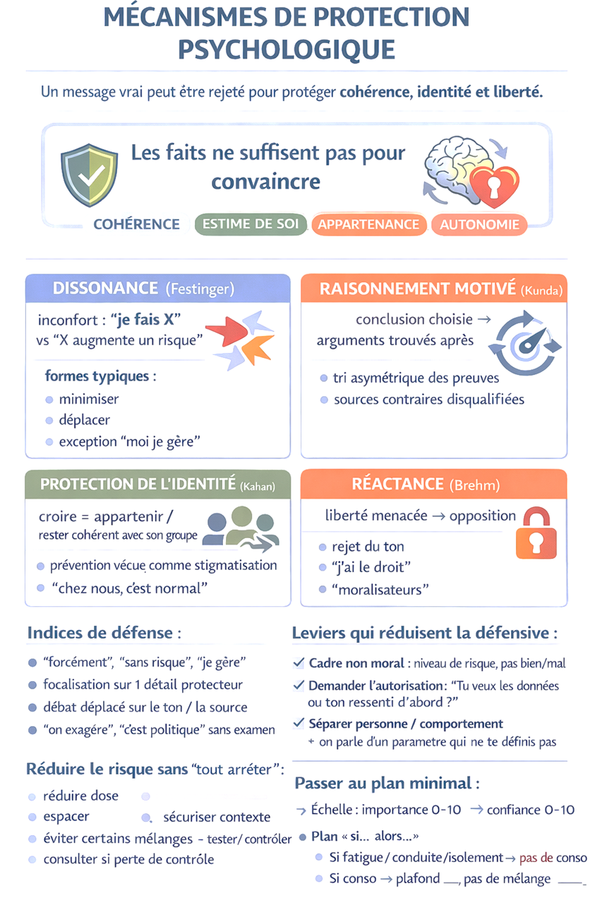
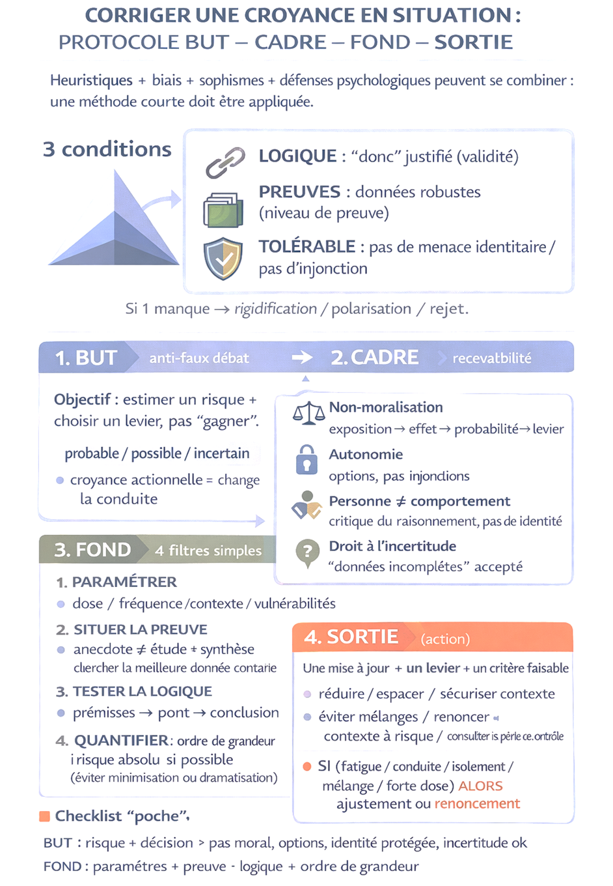

# Mécanismes de protection psychologique et approche RDR

### Mécanisme de protection psychologique

Lorsqu’il est question de
drogues et de comportements à risque, la logique ne suffit pas. Une croyance
peut être défendue par des mécanismes psychologiques dont la fonction n’est pas
de rechercher la vérité, mais de protéger la cohérence interne , l’estime
de soi , l’appartenance et la liberté perçue .

Dans ce cadre, une correction
factuelle peut être vécue comme une menace et déclencher des réponses
défensives. Ces réponses ne signifient pas que la personne “ne comprend pas”,
mais qu’elle protège une cohérence psychologique.

Quatre mécanismes dominants
seront présentés ici : dissonance cognitive , raisonnement motivé ,
 protection de l’identité , réactance . Ils interagissent souvent,
et expliquent pourquoi un message vrai peut être rejeté même lorsqu’il est
compris.

#### Dissonance cognitive

La dissonance cognitive
(Festinger, 1957) décrit l’inconfort psychologique ressenti quand deux idées
entrent en conflit, typiquement un comportement et une
connaissance/valeur (« je consomme » vs « cela augmente un risque »). La
réduction de cette tension ne passe pas nécessairement par un changement de
comportement ; elle peut passer par une modification du discours intérieur
(minimiser, relativiser, créer une exception) [[29]](/references#ref-29) .

Dans le champ des drogues. La dissonance est
fréquente lorsque la personne connaît une partie des risques mais maintient
l’usage. Elle peut réduire l’inconfort via :

Signaux typiques (observables).

#### Raisonnement motivé

Là où le biais de confirmation décrit une sélection biaisée
des informations, le raisonnement motivé met en évidence la cause profonde de
cette sélection : la conclusion est implicitement choisie à l’avance, puis
défendue par un raisonnement qui se donne l’apparence de la neutralité.

Décrit notamment par Ziva Kunda [[30]](/references#ref-30)
au début des années 1990, le raisonnement motivé correspond à un processus par
lequel la réflexion n’est pas orientée vers la recherche de la vérité, mais
vers la préservation d’une conclusion jugée acceptable, rassurante ou
compatible avec un comportement existant.
L’analyse n’est pas absente ; elle est mobilisée. Cependant, elle est orientée
par un objectif implicite : ne pas remettre en cause ce que l’on fait, ce à
quoi l’on tient, ou l’image que l’on a de soi .

Dans le champ des drogues. Exemples typiques (non
limités à l’alcool) :

Signaux typiques.

#### Protection de l’identité

Nos opinions et nos habitudes
font souvent partie de qui nous sommes . Dan Kahan [[31]](/references#ref-31)
(2012) parle de “cognition protectrice de l’identité” pour
décrire le fait que nous filtrons les informations en fonction de leur
accord avec les valeurs de notre groupe culturel .

Autrement dit, on a tendance à défendre les
croyances de son clan parce qu’elles sont liées à notre identité
sociale, quitte à ignorer des faits contraires. Ce mécanisme explique par
exemple les clivages sur des sujets comme le climat, les vaccins, etc., où
l’appartenance politique ou culturelle prédomine sur l’analyse objective des
données. Chacun “reste sur sa ligne” pour rester cohérent avec son groupe de
référence, les faits présentés (aussi solides soient-ils) sont rejetés non sur
le fond scientifique, mais pour protéger l’honneur ou la cohésion du
groupe.

Dans le champ des drogues. L’identité peut être
personnelle ( l’image que j’ai de moi-même ) ou collective ( l’image de
mon groupe ), et souvent les deux s’entremêlent. Une personne peut se
percevoir comme « quelqu’un de prudent et responsable » :
admettre qu’elle prend un risque en buvant régulièrement remettrait en cause
cette image d’elle-même.

De même, un groupe d’amis ou une communauté peut normaliser
une pratique ( « chez nous, on boit mais on n’a pas de
problèmes » ).

Un discours de prévention venant de l’extérieur peut alors
être perçu comme une stigmatisation du groupe – « on
veut nous faire passer pour des inconscients ou des malades » . Par
conséquent, les faits présentés (aussi solides soient-ils) sont rejetés non sur
le fond scientifique, mais pour protéger l’honneur ou la cohésion du
groupe . C’est un réflexe de protection identitaire.

C’est notamment visible quand des messages de santé publique
sur l’alcool rencontrent des résistances particulières dans des milieux où la
consommation fait partie de la culture conviviale : critiquer l’alcool,
c’est “faire insulte” à un art de vivre national, familial ou
autre. De même, un usager régulier de cannabis qui s’identifie à une
contre-culture pro-cannabis aura du mal à accepter des données négatives sur le
cannabis – cela irait à l’encontre de l’idéologie positive de son groupe.

#### Réactance psychologique

Le concept. Décrit par Jack W. Brehm (1966) [[32]](/references#ref-32) ,
la réactance est une réaction motivationnelle de rejet lorsqu’une liberté
perçue est menacée : un message injonctif peut déclencher opposition, défiance,
et parfois renforcement du comportement. Les travaux expérimentaux et synthèses
montrent que des messages perçus comme contraignants augmentent typiquement la
réactance et diminuent l’adhésion.

Dans le champ des drogues.

Signaux typiques.

#### Lever les freins psychologiques

L’objectif est de rendre l’accueil
de l’information sans attaque identitaire, et convertir l’inconfort en petit
plan d’action.

1) Poser un cadre non moral, orienté “niveau de risque”

« On ne parle pas de faute. On parle de niveau de risque
à ce niveau d’exposition et de ce qu’on peut ajuster. »

2) Demander l’autorisation avant d’informer (réduit la
défensive)

« Tu veux que je te donne les données connues sur ce point,
ou tu préfères qu’on reste sur ton ressenti d’abord ? »

3) Dissocier “valeur” et “comportement” (désamorçage
identitaire)

« Avoir ce comportement ne dit pas qui tu es. On parle d’un
paramètre modifiable, pas de ta valeur. »

« Reconnaître un risque = reprendre du contrôle, pas se
condamner. »

4) Faire émerger l’ambivalence (et le “change talk”) au
lieu d’argumenter

Objectif : que la personne formule elle-même une raison de
bouger.

« Donc d’un côté X t’apporte ___, et de l’autre tu vois ___
comme risque. »

Cette technique, issue de l’entretien motivationnel [[33]](/references#ref-33) ,
vise précisément à explorer ces raisons personnelles et à résoudre
l’ambivalence dans un climat d’acceptation et de soutien de l’autonomie.

5) Travailler en “menu d’options réalistes” (pas en
injonction)

Proposer 3–6 leviers concrets, et laisser choisir.

Formulation type :

« Si tu voulais juste baisser le risque sans tout changer,
parmi ces options, laquelle te paraît faisable cette semaine ? »

6) Passer du “je devrais” à un micro-engagement mesurable

« Si je suis fatigué / si je dois conduire / si je suis
seul, alors je ne consomme pas. »
« Si je consomme, alors je limite à ___ et je ne mélange pas avec ___. »

7) Style de communication (3 réflexes)

« Voilà ce que j’ai compris… Est-ce que j’ai bon ? Qu’est-ce
que tu veux garder / jeter ? »

8) Petite phrase “anti-dissonance” à insérer telle quelle

« Ici, l’objectif n’est pas d’avoir raison ou tort : c’est
d’aligner ce que tu veux pour toi (sécurité, contrôle, santé, plaisir) avec des
choix concrets qui réduisent le risque. »

(Et côté evidence : la synthèse Cochrane récente décrit
le MI comme une méthode centrée sur la personne, visant à renforcer
motivation/engagement via exploration des raisons personnelles et résolution de
l’ambivalence, avec un style d’acceptation et de compassion ; les effets moyens
observés sur la réduction d’usage sont plutôt modestes et variables selon
comparateurs et contextes.)

<figure class="doc-figure">
  
  <figcaption>Un message factuel peut être rejeté pour protéger cohérence, identité ou liberté perçue.</figcaption>
</figure>

### Approche en réduction des risques

En pratique, ces mécanismes se
combinent. Une heuristique peut orienter une première impression, un biais peut
sélectionner les informations compatibles, un sophisme peut donner une
apparence de démonstration, puis la dissonance ou la réactance peuvent verrouiller
l’ensemble. L’analyse “par thème” aide à comprendre chaque mécanisme isolément
; mais dans la vie réelle — et a fortiori lorsqu’il s’agit de substances
psychoactives — il faut une méthode plus générique, applicable en situation.

Une croyance ne se corrige
correctement que si trois conditions sont réunies : (1) le raisonnement
est valide (le « donc » est justifié), (2) les données mobilisées sont
robustes (niveau de preuve suffisant), (3) l’échange reste
psychologiquement tolérable (sans menace identitaire ni injonction qui
déclenche la défensive). Si l’une de ces conditions manque, la discussion peut
produire l’effet inverse : rigidification de la croyance, polarisation, ou
rejet du message.

Une conséquence pratique en
découle : les discussions sur les drogues échouent rarement par manque
d’informations , mais par absence de règles du jeu. Sans cadre explicite,
l’échange dérive vers l’opinion, la morale, l’anecdote, ou l’attaque
personnelle. Dans ce contexte, un message exact peut devenir inaudible, non pas
parce qu’il est faux, mais parce qu’il est reçu comme une menace ou comme une
tentative de contrôle. La réduction des risques repose donc sur une autre
logique : dépassionnée, paramétrée, orientée décision .

L’objectif n’est pas de “gagner” un débat, mais de mettre
à jour une croyance de manière utilisable , c’est-à-dire : préciser
l’exposition (dose, fréquence, contexte), cibler l’effet pertinent, reconnaître
l’incertitude, puis en déduire un levier concret de réduction des risques.

Le protocole BUT – CADRE – FOND – SORTIE formalise
cette démarche. Il constitue un contrat entre le lecteur et le livre :
lorsqu’une affirmation surgit (« c’est sans danger », « ça aide », « on exagère
»), on applique une séquence courte qui neutralise les pièges décrits dans le
chapitre (heuristiques, biais, sophismes, mécanismes de protection), et ramène
la discussion vers ce qui compte : une estimation raisonnable du risque et
une décision praticable.

##### 1) BUT : clarifier la finalité (éviter le faux débat)

Une discussion utile commence par une question simple : pour
quoi discute-t-on ?

Dans le champ des substances psychoactives, le but le plus
robuste n’est pas d’obtenir une adhésion morale, mais de produire deux
résultats :

Ce cadrage évite deux dérives fréquentes :

• Le débat moral (bien/mal), qui déclenche la défensive et
bloque la mise à jour.

• Le débat binaire (« safe / dangereux »), alors que le
risque est généralement dose – contexte – vulnérabilité – répétition .

Une croyance devient un problème en réduction des risques
lorsqu’elle est actionnelle : elle modifie la conduite (dose, fréquence,
contexte, mélanges, précautions).

Le BUT consiste donc à cibler ce qui compte :

• Qu’est-ce que cette croyance change dans l’action ?

• Quel dommage plausible ou fréquent rend cette croyance
problématique ?

##### 2) CADRE : rendre l’échange recevable (sinon le fond ne passe pas)

Dans les sujets à forte charge
sociale, une correction factuelle peut être vécue comme une menace (image de
soi, appartenance, autonomie). Les mécanismes décrits plus haut (dissonance,
raisonnement motivé, protection identitaire, réactance) s’activent alors, et
l’argumentation bascule du contenu vers la posture.

Le CADRE a une fonction claire : réduire
la menace perçue pour permettre l’examen des faits .

Un cadre minimal repose sur quatre règles :

- Non-moralisation
On parle d’exposition, d’effets, de probabilité et de leviers. Pas de faute,
pas de “bon/mauvais”.

- Autonomie
La discussion porte sur des options possibles. Une injonction augmente la
réactance ; un choix explicite la réduit.

- Séparation personne / comportement

Critiquer une pratique ou un raisonnement
n’est pas juger une valeur humaine. Cette séparation diminue la défense
identitaire.

- Droit à l’incertitude

Dire “les données sont incomplètes” est
acceptable. Les sujets de toxicologie et de santé publique impliquent souvent
de l’incertitude ; la nier fabrique de la défiance.

Sans ce cadre, la discussion se transforme en conflit de
loyauté, de style, ou de statut. Le CADRE est donc une condition de possibilité
du raisonnement.

##### 3) FOND : traiter l’affirmation comme un problème de risque (pas comme une opinion)

Le FOND ne demande pas d’être “expert”. Il demande d’éviter
des erreurs prévisibles. Les mécanismes décrits dans le chapitre peuvent être
convertis en quatre filtres simples.

Filtre 1 — Paramétrer (anti-heuristique)

Si une phrase sur une substance psychoactive ne contient ni
dose, ni fréquence/durée, ni effet, ni contexte, ce n’est pas une évaluation du
risque : c’est une impression.

Paramètres minimaux : dose , fréquence , contexte
(conduite, chaleur, isolement, fatigue, médicaments), vulnérabilités .

Filtre 2 — Sourcer (anti-biais)

Avant de conclure, il faut situer le niveau de preuve.

La croyance repose-t-elle sur : une anecdote, une
impression, une étude isolée, ou un ensemble convergent (synthèses,
méta-analyses, rapports d’expertise) ?

Règle anti-confirmation : chercher activement la meilleure donnée contraire
avant de conclure. La question clé n’est pas « qu’est-ce qui va dans ce sens ?
» mais : quelle est la meilleure preuve solide qui contredit cette
conclusion ?

Filtre 3 — Tester la logique (anti-sophismes)

Les sophismes s’installent quand la logique n’est pas bonne
: corrélation → causalité ; probabilité → certitude ;
exception → règle.

Il faut mettre l’argument à plat :

- prémisses (ce qui est posé),

- pont logique (ce qui autorise le passage),

- conclusion (ce qui est affirmé).

En toxicologie et santé publique, le raisonnement est
souvent probabiliste : parler de risque augmenté est légitime ; parler
en termes de « forcément » est généralement abusif.

Filtre 4 — Quantifier (anti-illusions de grandeur)

Les pourcentages relatifs peuvent tromper. Dès que possible,
traduire en :

- ordre de grandeur,

- risque absolu (ou fréquences),

- comparaison pertinente (population, horizon temporel, contexte
comparable).

L’objectif n’est pas une précision artificielle, mais d’éviter deux erreurs
symétriques : amplification

dramatique ou minimisation.

##### 4) SORTIE : transformer l’analyse en décision de réduction des risques

Un débat RDR réussi ne se termine pas par une victoire
rhétorique, mais par une sortie actionnable . Sans sortie, la correction
reste théorique et la croyance actionnelle peut rester intacte.

La sortie doit produire trois éléments :

Une forme particulièrement robuste consiste à conclure par
une règle conditionnelle (« si… alors… »). Come par exemple : « Si
contexte à risque (fatigue, conduite, isolement, mélange, forte dose), alors
ajustement ou renoncement » ou encore « Si consommation, alors plafond de
dose + règle d’espacement + règle d’évitement des mélanges à haut risque. »

En réduction des risques, l’optimisation se fait par
itérations : une amélioration stable (même partielle) a plus de valeur
qu’une vérité complète sans effet sur la conduite.

Check-list (version courte à mémoriser)

**BUT**

**CADRE**

**FOND**

**SORTIE**

##### Exemples

Les exemples qui suivent montrent comment appliquer le
protocole BUT – CADRE – FOND – SORTIE en conditions réelles, avec leurs
contraintes.

Selon le contexte, il n’y a pas toujours la place à une
“correction complète” d’une croyance : l’objectif devient alors une mise à
jour minimale mais utile , orientée vers une décision de réduction des
risques .

Chaque scène part d’une croyance
actionnelle (qui modifie la conduite) et illustre comment ramener l’échange
vers une estimation raisonnable du risque, puis vers une sortie praticable,
sans moraliser ni déclencher un conflit de posture.

Les dialogues sont un mélange de conversations réelles et
fictionnelles :

###### Exemple dans une conversation sur le cannabis entre ami

Dans l’exemple cannabis
ci-dessous, la scène se passe en tête-à-tête, entre deux amis qui se
connaissent bien. « A » n’est pas “en débat” : il cherche surtout à
protéger une image cohérente de lui-même (quelqu’un qui gère, qui ne fait pas
n’importe quoi) et à préserver un bénéfice immédiat (détente, sommeil,
sociabilité, routine). « B », de son côté, n’a pas un public à
convaincre : il a une fenêtre rare où l’échange peut rester calme et précis,
sans enjeu de statut.

Mais cette proximité a son propre
risque : si B donne une leçon, A peut se braquer par réactance (“tu me
contrôles”) ou par dissonance (“tu me forces à voir un risque que je préfère
tenir à distance”). Le déclencheur de la discussion n’est pas l’usage en soi ;
c’est une croyance actionnelle du type « c’est naturel, donc c’est safe / ça
passe bien, donc c’est sans risque », qui peut conduire à des décisions
concrètes à risque (augmenter la fréquence, banaliser certains contextes,
relâcher la vigilance sur la conduite, les mélanges, la fatigue, l’isolement,
ou renoncer à des précautions simples).

L’intervention de B doit donc
être courte, non moralisatrice, centrée sur les paramètres (dose,
fréquence, contexte, effets) et viser une sortie praticable — pas une
conversion idéologique.

« A : Franchement le cannabis, c’est
naturel. On dramatise trop. C’est pas vraiment dangereux.

B : Ok. Je ne vais pas te faire la morale.
Mais si on en parle, j’aimerais qu’on parle utile : pas “pour/contre” ,
plutôt “à quel niveau de risque dans quelles conditions”. Ça te va ?

A : Ouais, mais c’est simple : c’est une
plante. Et puis je connais plein de gens qui fument, ils ont jamais eu de
souci.

B : Je t’entends. Juste, quand tu dis “pas
dangereux”, tu parles de quoi exactement ? Santé à long terme ?
Accidents ? Dépendance ? Anxiété ? Travail ?

A : Surtout santé… et bon, j’ai pas
l’impression d’être un danger. Je gère. Je fume surtout le soir.

B : D’accord. Pour situer, c’est combien
de fois par semaine ? Et c’est quel contexte : seul, en groupe, alcool,
conduite, fatigue… ?

A : En général 3–4 soirs par semaine. Et ça
m’arrive de rentrer en voiture le lendemain matin, mais je suis clean, je dors.

B : Ok, donc on n’est plus sur “cannabis en
général”, on est sur “3–4 soirs/semaine + conduite le lendemain”. Là, le point
sensible, ce n’est pas “plante ou pas plante”. C’est : est-ce que ton
niveau d’exposition + ton contexte augmente ton risque d’accident ou de baisse
d’attention, même si tu ne le sens pas ?

A : Je sais pas… moi je me sens normal.

B : Le ressenti est un indicateur utile,
mais il n’est pas fiable pour la vigilance. Beaucoup de gens se sentent “ok” et
sous-estiment l’impact sur l’attention ou les temps de réaction. Et comme
c’est un risque probabiliste , le fait que ça se soit bien passé
jusqu’ici ne prouve pas que le risque est nul .

A : Oui mais tu vois, ça revient toujours à
dire que c’est dangereux. On exagère.

B : Je ne dis pas “dangereux” au sens
“catastrophe certaine”. Je dis : le risque dépend de paramètres. Et ton
argument “c’est naturel donc pas dangereux”, il saute une étape. “Naturel”
ne dit rien sur la dose, la répétition, le cerveau, la conduite, ni les
vulnérabilités. Il y a des plantes très toxiques, et des molécules synthétiques
à faible toxicité. Donc la propriété “naturel” n’est pas un critère pertinent
pour conclure sur le risque.

A : Mouais… mais tu vois, on trouve
toujours une étude pour dire tout et son contraire.

B : C’est vrai qu’on peut cherry-picker
(prendre une étude qui nous arrange). Du coup, règle simple : avant de
trancher, on cherche aussi la meilleure donnée contraire à ce qu’on a envie de
croire. Et on regarde surtout les synthèses et les consensus, pas juste une
étude ou une vidéo.

A : Ok… mais moi je n’ai pas de problème,
je bosse, je suis pas dépendant.

B : Je ne dis pas que tu es dépendant. Là,
je vise juste un point actionnable : la combinaison “usage régulier” +
“conduite” est une zone où le risque peut augmenter sans être perçu. Et si on
est en réduction des risques, on n’a pas besoin d’avoir une certitude totale
pour ajuster un paramètre.

A : Donc tu proposes quoi ? Arrêter ?

B : Pas forcément. Je propose qu’on
sorte du tout-ou-rien . Si tu voulais juste baisser le risque sans tout
changer, il y a plusieurs leviers possibles :

- Éviter de conduire après consommation, et éviter aussi quand
tu as un doute sur l’effet résiduel,

- Réduire la fréquence (par exemple 3–4 soirs → 1–2 soirs)
ou instaurer des jours “off”,

- Éviter mélanges alcool + cannabis, surtout si tu dois gérer un
trajet,

- Et si tu remarques anxiété, baisse de motivation ou sommeil
dégradé, faire une période-test avec une règle claire.

A : Ouais… le truc le plus simple, c’est la
conduite. Je peux éviter si j’ai fumé la veille.

B : Parfait. On peut même le formuler en
règle : si j’ai consommé la veille, alors pas de conduite le
lendemain matin, ou je décale. Et on réévalue dans un mois si ça change
quelque chose sur ton stress, ton sommeil, et si ça te coûte trop.

A : Ok, ça me va. Là je le prends mieux.
Parce que “t’es en danger” ça me saoule.

B : Normal. Le but c’est pas de te coller
une étiquette. Le but c’est d’ajuster deux-trois paramètres qui réduisent le
risque , sans te raconter d’histoires sur “zéro danger”. »

Dans l’exemple ci-dessous, B
applique le protocole : il clarifie d’abord le BUT en recadrant la
discussion sur une estimation du risque dans des conditions données et
sur une décision de réduction des risques (« à quel niveau de risque, dans quel
contexte, et qu’est-ce qu’on ajuste ») ; il pose ensuite le CADRE en
neutralisant la moralisation, en préservant l’autonomie et en séparant la
personne du comportement (« pas de jugement, on regarde les paramètres, vous
gardez la main ») ; sur le FOND , il transforme l’affirmation en problème
de risque en la paramétrant (dose, fréquence, contexte, effets), en situant
les preuves et en testant le “donc” pour éliminer les sauts logiques
; enfin, il produit une SORTIE actionnable sous forme d’une mise à jour
plus précise + un levier concret, formulé en règle conditionnelle (« si X,
alors Y »), faisable immédiatement.

###### Exemple dans une conversation en public sur l’alcool

Dans cet exemple, la scène se
déroule lors d’un dîner professionnel. La discussion n’a rien d’un échange
“neutre” : il y a un public, des enjeux d’image, de statut, d’appartenance au
groupe. Celui qui parle (A) ne cherche pas seulement à décrire un fait ; il
protège une identité implicite (« nous, on sait boire », « nous, on a du goût
», « nous ne sommes pas les jeunes à la piquette »). Dans ce contexte, une
correction frontale fonctionne mal : elle humilie, déclenche la réactance,
rigidifie la position, et fait basculer l’échange du fond vers la posture.

L’intervention de B est donc contrainte : temps de parole
limité, impossibilité de “faire un cours”, nécessité de rester acceptable
socialement, et obligation de ne pas casser l’ambiance.

L’objectif réaliste n’est pas de
rééduquer toutes les croyances de A, mais d’introduire une mise à jour minimale
sans affrontement, puis de déplacer la discussion vers une décision concrète.

Autrement dit : accepter de
laisser passer certains arguments faibles, éviter de répondre à tout, et
concentrer l’effort sur ce qui modifie effectivement les conduites.

Le déclencheur, ici, est une
croyance actionnelle : « bon vin = faible risque ». Ce type d’idée peut
favoriser des comportements à risque parce qu’il baisse la vigilance face au
risque : augmentation de fréquence, banalisation de la répétition et surtout
relâchement des garde-fous contextuels (conduite, fatigue, médicaments,
quantité).

La stratégie de B consiste donc à
ne pas contester l’identité (“le plaisir”, “le bon vin”), mais à recadrer
discrètement la question sur ce qui compte en réduction des risques : quantité,
répétition, contexte immédiat — puis à terminer par une sortie praticable
(s’organiser pour la conduite).

« A : Ça va… nous on boit du bon vin. Le vrai
problème, c’est la piquette. Et puis tous leurs trucs chimiques.

B : Je vois. Bon vin = tranquille. Après… juste pour être
clair : on parle bien santé, pas bien/mal, hein.

A : Bah oui, mais on nous bassine avec l’alcool. On en
boit depuis toujours. Ma grand-mère a 99 ans, son petit rouge elle le bois tous
les jours.

B : Elle a une sacrée génétique, respect. Mais c’est un
exemple. Ça ne dit pas ce que ça fait en moyenne , sur des années, quand
ça se répète.

A : (enchaîne, devant les autres) Et puis bon… le vrai
tueur aujourd’hui, c’est le sucre. Pas le vin.

B : Le sucre est un vrai problème, oui. Mais il y a
pire n’efface pas le reste . On peut avoir deux sujets vrais en même temps.

A : N’empêche : le bon vin, c’est pas pareil. La piquette
que boivent les jeunes, c’est plein de merdes.

B : (ton neutre, pas professoral) Sur la gueule de bois,
peut-être. Sur le risque santé à long terme… ce qui pèse le plus, c’est surtout
combien d’alcool et a quelle fréquence . La qualité change le plaisir, pas la
règle biologique de base.

A : (piqué) Donc bon ou pas bon, c’est pareil ?

B : (sourire) Si je réponds sérieusement, on va finir
avec un tableau Excel et je vais me faire détester. Disons : bon = meilleur
goût. Mais ça protège ou c’est sans risque : non.

A : Franchement, on exagère. Moi je gère.

B : Je ne dis pas le contraire. Juste : « je gère »,
ça ressemble à quoi ? Un verre quasi tous les soirs ? ou plutôt deux-trois fois
dans la semaine ?

A : (obligé de préciser, sans perdre la face) Ben…
souvent un verre. Et le week-end un peu plus.

B : Ok. Sans casser le délire : si vous gardez quelques
soirs sans alcool dans la semaine, vous baissez l’exposition sans vous priver.
Et là, tout de suite, le truc simple : qui reprend le volant ce soir ?

A : (saisit la sortie honorable) Oui, qui conduit ? On
s’organise.

B : Voilà. On garde le dîner… et on évite la connerie la
plus chère. »

Dans l’exemple ci-dessous, B a
appliqué les règles. Il a clarifié le BUT en refusant le débat
“pour/contre” et en ramenant l’échange vers une question opératoire (« de quoi
parle-t-on exactement : quel niveau de risque, dans quelles conditions, et
qu’est-ce qu’on peut ajuster sans plomber la soirée ? »). Le CADRE a été
posé en neutralisant la menace sociale : ton non moral, temps de parole court
annoncé, absence d’attaque personnelle, et respect de l’autonomie (il propose
un point bref et laisse la porte ouverte, au lieu d’imposer). Sur le FOND ,
il a utilisé des filtres simples : il a fait préciser l’affirmation (quantité,
fréquence, contexte), a désamorcé les raisonnements fallacieux typiques
(“naturel/qualité = sûr”, “pas d’incident = pas de risque”, “on a toujours fait
comme ça”, “et le sucre alors…”) sans entrer dans une joute, et a ramené
l’évaluation au bon niveau de certitude (risque probabiliste, surtout lié à
l’exposition et au contexte). Enfin, il a trouvé une SORTIE actionnable
en concluant par un ajustement concret et socialement acceptable — une décision
immédiate sur le contexte (conduite/organisation du retour), plutôt qu’une
tentative de convaincre sur toute la toxicologie de l’alcool.

###### Exemple dans le cadre d’une prise en charge sur un stand RDR

L’exemple se déroule sur un stand
de RDR en festival, fin de soirée. Un participant a fait un malaise sans
perte de connaissance (palpitations, tremblements, anxiété, nausée, coup de
chaud).

Ses amis sont stressés et très
attachés à l’idée que ce n’est pas “leur” consommation : devant le groupe,
ils avancent “on l’a drogué” ou “taz coupé”.

Ici, l’enjeu n’est pas de
“corriger tout” sur place : la priorité est de réduire le risque immédiat,
éviter une escalade (redrop, alcool, reprise de danse, excitants), et obtenir
une sortie simple, applicable tout de suite, sans humilier ni monopoliser la
parole.

« A : Ça y est… il est
parti en vrille d’un coup. On lui a mis un truc dans son verre, c’est sûr. Ou
le taz était coupé.

B : Ok. Il est conscient ?
Il répond quand on lui parle ? Il respire normalement ?

A : Oui, il répond, mais il
panique. Il dit que son cœur explose. Franchement c’est pas “nous”, on gère.

B : D’accord. On va surtout
faire ce qui baisse le risque maintenant . J’ai besoin de deux-trois
infos rapides, ça vous va ?

A : Vas-y, mais je te le dis :
c’est pas la MD. On en a déjà pris, jamais eu ça.

B : Je comprends. Là, ce qui
compte, c’est ce soir. C’était quand la prise ? Et en gros : demi, un
entier, redrop ?

A : Vers minuit. Un entier.
Pas de redrop. Et on a bu un peu, comme tout le monde.

B : Ok. “Un peu”, ça peut
être deux verres comme six . Vous diriez quoi, honnêtement ? Et il a dansé
longtemps sans pause ? Il a pu se poser au frais ?

A : …Ouais, plusieurs verres.
Et il a dansé non-stop. On a chaud, ok. Mais ça n’explique pas un malaise comme
ça. Si c’était juste l’alcool, tout le monde tomberait.

B : Je vois l’idée, mais en
pratique ça ne marche pas comme ça. Les réactions varient beaucoup selon la
dose, la chaleur, la fatigue, et la sensibilité de chacun . Deux personnes
peuvent faire la même soirée et ne pas réagir pareil.

A : N’empêche, le taz pouvait
être dégueulasse et coupé. Et si quelqu’un lui a mis un truc dans son verre?

B : C’est possible. Là, on ne
peut pas trancher sur place. Et surtout, la conduite à tenir dans les dix
prochaines minutes ne change pas : on baisse la charge sur le corps, on
surveille, et on se garde des critères clairs si ça se dégrade.

A : Ok, mais tu veux qu’on
fasse quoi, là, maintenant ?

B : D’abord : on le met assis
ici, à l’écart, au frais. On ventile, on enlève la couche en trop. Pas
d’alcool, pas de redrop, pas de “truc pour le calmer”, pas de boisson
énergisante. Eau : petites gorgées, pas une bouteille d’un coup. Et surtout, on
ne le laisse pas seul.

A : Il dit qu’il va
s’évanouir…

B : Ok. On ralentit :
respiration lente, on reste avec lui, on le rassure sans le secouer. Vous me
dites si ça change. Les signaux qui font appeler l’équipe médicale tout de
suite : confusion importante, vomissements répétés, douleur thoracique,
difficulté à respirer, perte de connaissance, convulsions, agitation
incontrôlable, température très élevée, ou aggravation malgré repos au frais.

A : Donc tu penses que c’est
surtout le mélange et la chaleur.

B : Je pense que c’est
l’explication la plus probable et la plus utile pour décider maintenant. Après,
quand ça ira mieux, on pourra reparler “qualité / composition” et voir si vous
pouvez faire analyser ce qu’il reste. Mais là, la priorité, c’est de stabiliser
et d’éviter que ça parte plus loin.

A : Ok. On stop tout, on le
pose, on surveille.

B : Parfait. Et si vous
devez retenir une règle simple pour la suite : MDMA + alcool + chaleur, c’est
une combinaison à risque. Donc pauses au frais, pas d’alcool, et pas de redrop
“pour rattraper”. »

Dans l’exemple ci-dessus, B a
utilisé les règles. Il a clarifié le BUT en ramenant immédiatement
l’échange vers une question opérationnelle (quoi faire maintenant) plutôt que
vers un procès en causalité (qui a raison, produit coupé ou non).

Le CADRE a été posé en
restant bref, non moralisateur, et en demandant l’accord avant de questionner,
ce qui réduit la réactance et évite d’exposer A devant le groupe.

Sur le FOND , B a paramétré
l’exposition (heure, dose, absence de redrop, alcool, chaleur, absence de
pauses), a neutralisé une fausse règle implicite sans attaquer la personne (si
c’était l’alcool, tout le monde tomberait), et a remis l’hypothèse
“coupé/drogué” au bon niveau (possible mais non tranchable, et non déterminante
pour l’action immédiate).

Enfin, il a obtenu une SORTIE
actionnable : mise au frais, arrêt alcool/redrop/excitants, hydratation
prudente, présence continue, et critères simples d’escalade vers l’équipe
médicale.

### Conclusion

Une conclusion peut être posée
simplement : les croyances fausses, ne relèvent pas d’un “manque
d’intelligence”, mais d’un fonctionnement humain normal sous contrainte (temps,
attention, enjeux sociaux).

Avec les substances
psychoactives, la difficulté est renforcée : le risque est souvent varié et le
sujet est chargé culturellement. Dans ces conditions, une discussion
ordinaire ne fournit presque jamais le cadre nécessaire à une analyse complète
: les paramètres manquent (dose, fréquence, contexte, vulnérabilités), le
niveau de preuve n’est pas clarifié, et la correction factuelle peut être vécue
comme une menace pour l’identité ou l’autonomie. Une mise à jour ne doit donc
pas être attendue en quelques minutes, et une “conversion” n’a aucune raison de
se produire sous pression sociale.

Une stratégie réaliste consiste à viser des petites
victoires. Une croyance actionnelle n’a pas besoin d’être démolie pour que le
risque baisse : une phrase moins absolue, un “donc” reformulé au bon niveau
(“risque augmenté” plutôt que “sans danger”), un paramètre ajouté (quantité,
répétition), ou un garde-fou contextuel adopté (pas de conduite, pas de mélange
à haut risque, jours “off”, plafond de dose) suffisent souvent à produire un
gain concret.

La réduction des risques se
joue sur ces ajustements stables, répétés, et faisables, plus que sur une
vérité parfaite impossible à appliquer au quotidien. L’outil proposé dans
ce chapitre (BUT – CADRE – FOND – SORTIE) a précisément cette fonction : rendre
une mise à jour factuelle tolérable psychologiquement, puis la convertir en
décision praticable.

La suite de cette partie “Mythes”
s’inscrit dans la même logique. Une relation aux drogues est en grande partie
construite par des croyances héritées, des normes de groupe, des intuitions, et
des récits médiatiques ; ces couches ne se corrigent pas par une formule
(“c’est scientifique”) ni par une opinion opposée.

Un détour par un chapitre sur ce
qu’est la science devient alors nécessaire : non pour sacraliser la science,
mais pour comprendre comment une conclusion solide est produite , comment
l’incertitude est gérée, et comment le niveau de preuve est distingué d’un
simple argument d’autorité.

Ensuite, des mythes précis seront
déconstruits comme des cas d’école : non pour “avoir raison”, mais pour
apprendre à mieux poser les questions, à repérer les raccourcis typiques, et à
raisonner de manière moins biaisée sur des sujets qui, par nature, ne se
prêtent pas aux réponses rapides.

Enfin, un point doit être assumé
clairement : une approche rigoureuse exige du temps. Un traité long, appuyé sur
des synthèses, des rapports d’expertise et une littérature abondante, ne vise
pas à être récité en conversation ; il vise à équiper le lecteur.

Dans la vie courante, l’objectif
ne sera pas de reproduire une revue systématique, mais d’éviter les erreurs
prévisibles et de retenir quelques repères robustes : préciser l’exposition,
chercher le niveau de preuve, refuser les conclusions absolues, et terminer par
un levier simple. Ce cadre suffit déjà à rendre la réflexion plus froide, plus
utile, et plus compatible avec l’esprit de réduction des risques.

<figure class="doc-figure">
  
  <figcaption>Protocole BUT - CADRE - FOND - SORTIE pour rendre une correction plus recevable.</figcaption>
</figure>
