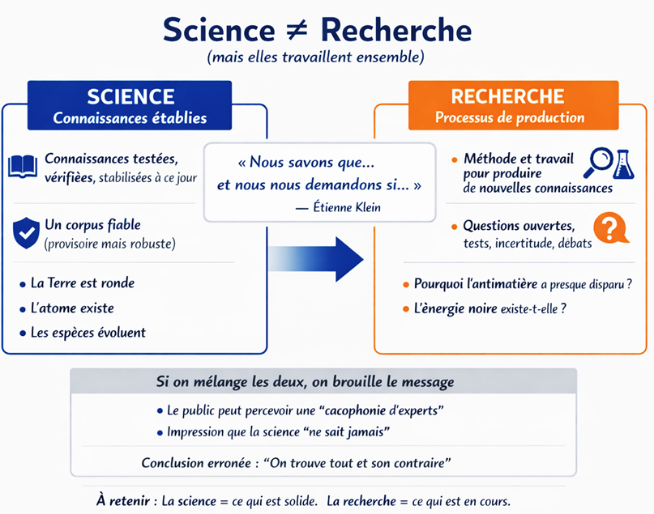
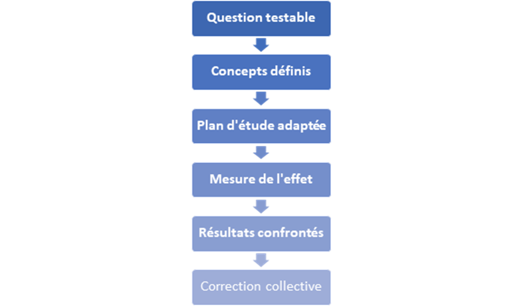

# Comprendre la science, preuves, causalité et méthode scientifique

## Comprendre la science

Souvent il est avancé qu’un argument qu’il est
“scientifique”, mais pour en comprendre la portée, il est essentiel de savoir
ce qu’est la science, comment elle fonctionne, et surtout comment interpréter
les publications sur lesquelles ce livre s’appuie.

Cette partie s’articulera autour de plusieurs points : la
distinction entre science et recherche, une présentation des principes de la
méthode scientifique et des niveaux de preuve, illustrée par des exemples
concrets. Elle se conclura par un aperçu des outils statistiques utilisés dans
les publications afin d’en faciliter la lecture et d’éviter les interprétations
abusives.

Ces notions sont également appliquée dans le chapitre
« Boire un verre de vin est bon pour la santé » avec une approche
plus historique.

### Science et recherche

La science et la recherche sont liées mais il
ne faut pas les confondre. La science c’est l’ensemble des connaissances
établies et vérifiées à ce jour , tandis que la recherche est le
processus par lequel de nouvelles connaissances sont produites.

Comme le souligne le physicien Étienne Klein [[34]](/references#ref-34) ,
un Philosophe des sciences, il faudrait idéalement déclarer : « Nous savons
que… et nous nous demandons si… » – la première partie faisant
référence aux acquis de la science, la seconde aux questions ouvertes de la
recherche.

Autrement dit, les sciences
représentent un corpus de savoirs testés et validés (par exemple : la
Terre est ronde, l’atome existe, les espèces évoluent ), qu’il n’y a pas
lieu de remettre en cause sans nouvelle preuve scientifique contraire solides. La
recherche , elle, s’attaque aux questions non résolues découlant des
limites de ces savoirs (par exemple : pourquoi l’antimatière a-t-elle
quasiment disparu de l’univers ? existe-t-il une énergie noire ? ). C’est en
explorant ces inconnues que la recherche fait progresser la science.

Si
l’on mélange ces deux plans, on risque de brouiller l’image de la science : le
public peut avoir l’impression d’une cacophonie d’« experts » jamais d’accord,
et ne plus savoir si la science « sait » ou « doute » et en venir à l’argument
« dans les publications on trouve tout et son contraire » D’où
l’importance de bien distinguer les connaissances scientifiques déjà solidement
acquises des chantiers de recherche en cours, qui par nature comportent du
doute et de l’incertitude.

Science=
Corpus de savoir validés par une méthode scientifique

Recherche=
Processus par lequel est créé du savoir scientifique

<figure class="doc-figure">
  
  <figcaption>Distinguer le corpus scientifique stabilisé des questions encore travaillées par la recherche.</figcaption>
</figure>

Figure 1.
Science et recherche

Une idée ne devient pas “science” dès qu’un papier sort, ni
même dès que plusieurs papiers vont dans le même sens. Elle entre dans le
corpus quand, progressivement :

Le tout converge vers une
conclusion assez stable pour être utilisée (prévention, clinique,
recommandations), avec un niveau d’incertitude résiduelle clairement borné.

Dans cette phase intermédiaire, il est normal d’observer des
résultats qui semblent se contredire : il ne s’agit pas forcément d’une
“science qui se trompe”, mais d’une recherche qui explore , qui affine
les conditions (“chez qui ? à quelle dose ? dans quel contexte ? avec quelles
co-consommations ?”) et qui réduit progressivement l’incertitude.

#### Exemple de la cigarette électronique

Le vapotage a constitué un bon
exemple de phase intermédiaire entre recherche et science. Au départ,
une question simple a été posée : la cigarette électronique réduit-elle le
risque par rapport au tabac fumé, et quels risques propres expose-t-elle ?

Une réponse scientifique n’a pas
pu être formulée immédiatement, car le recul a été faible et les méthodes
utilisées ont produit des résultats partiels, parfois perçus comme
contradictoires.

Dans un premier temps, des
résultats ont été obtenus par des approches différentes, chacune avec ses
limites. D’un côté, des travaux toxicologiques et réglementaires ont montré que
 les aérosols des cigarettes électroniques contiennent globalement moins de
composés nocifs que ceux des cigarettes de tabac , tout en restant porteurs
de substances irritantes ou toxiques selon les conditions d’usage, les liquides
et les dispositifs [[35]](/references#ref-35) .

D’un autre côté, des études
physiologiques et cliniques ont observé des effets respiratoires ou
cardiovasculaires potentiels, mais la comparaison directe a été compliquée par
la diversité des produits et par le fait que beaucoup d’usagers ont été d’anciens
fumeurs (ce qui a brouillé l’interprétation des effets propres du vapotage).

Enfin, une incertitude
structurelle a persisté sur les conséquences à long terme, car l’usage massif
est récent à l’échelle des maladies chroniques.

Progressivement, une conclusion plus stable et
opérationnelle a été rendue possible par la convergence des données [[36]](/references#ref-36)
:

Ainsi, ce qui est entré dans le corpus n’a pas été un slogan
(“inoffensif” ou “aussi dangereux que le tabac”), mais une formulation nuancée
: le vapotage est généralement moins nocif que le tabac fumé quand il
remplace totalement la combustion chez un fumeur, mais il n’est pas sans risque
et ne devrait pas être initié chez les non-fumeurs, surtout les jeunes .

#### Exemple de la neurotoxicité de la MDMA

Il est admis que la MDMA augmente fortement la libération
de sérotonine . Cette pharmacologie explique des effets aigus bien
documentés : une augmentation dose-dépendante de la température centrale
a été décrite chez l’humain, et les formes sévères observées en contexte
récréatif ont été associées à l’ hyperthermie [[37]](/references#ref-37) .

Ces points reposent sur des mécanismes pharmacologiques
cohérents et une convergence clinique, c’est dans le corpus scientifique.

La question “la MDMA abîme-t-elle
durablement le système sérotoninergique chez l’humain ?” est restée longtemps
incertaine, parce que les données ont été hétérogènes et parfois contradictoires
selon les méthodes.

Des atteintes de marqueurs sérotoninergiques
ont été mises en évidence dans plusieurs modèles animaux , mais la
discussion a porté sur la transposition à l’Homme (dose, fréquence
d’exposition, espèce) et sur le rôle des conditions expérimentales
(température, stress) susceptibles d’amplifier les effets.
Un signal préoccupant a donc été fourni, sans que l’extrapolation directe à
l’usage récréatif humain ait pu être considérée comme fiable.

Les études basées sur l’imagerie médicale mesurent
indirectement des marqueurs comme le SERT (c’est le transporteur de la
sérotonine dans le cerveau), pas les neurones eux-mêmes. Une baisse du SERT a
souvent été observée chez des usagers, mais une remontée partielle après
abstinence a aussi été décrite, ce qui laisse ouverte l’alternative entre
dommage durable et adaptation réversible. De plus, la population sur laquelle
était fait les examens médicaux ne consommait pas que de la MDMA [[38]](/references#ref-38) .

Les études en psychiatrie/psychologie montrent
une association entre usage de MDMA (surtout usage important) et déficits
cognitifs subtils, en particulier la mémoire, mais l’interprétation a été
rendue difficile par la poly-consommation de drogue, les différences de mode de
vie (sommeil, sorties), et des biais de sélection.

Autrement dit, un “bruit” méthodologique a été présent : une
partie des effets observés a pu être attribuée à des facteurs corrélés à
l’usage plutôt qu’à la MDMA seule.

Quand plusieurs angles ont commencé à converger, une
formulation plus robuste a pu être retenue :

Cette convergence a permis de sortir du binaire «
neurotoxique / pas neurotoxique » pour aller vers une position plus nuancée et
robuste : le risque existe et dépend de la dose, de la répétition, du
contexte et des co-consommations , et les conclusions doivent être formulées
en bornant clairement l’incertitude résiduelle.

### La méthode Scientifique

La science ne se résume pas à des
faits. Elle se définit d’abord comme une méthode : un ensemble de règles
qui obligent une idée à se confronter au réel, puis à la critique d’autres
équipes.

Cette méthode vise un objectif
simple : produire des connaissances testables , corrigeables et plus
fiables que l’intuition , même lorsque les humains (chercheurs inclus) sont
soumis aux biais, aux routines et aux intérêts.

Pour rendre ce mécanisme concret, un même fil rouge peut
être utilisé : la question très fréquente « le cannabis abîme-t-il la
mémoire ? ». Elle paraît simple, mais elle montre pourquoi la méthode
compte plus que les slogans.

<figure class="doc-figure">
  
  <figcaption>Étapes génériques permettant de transformer une question en hypothèse testable et confrontée aux données.</figcaption>
</figure>

Figure 2.
Etapes génériques de la méthode scientifique

#### 1) Question testable

Une démarche scientifique commence par une formulation qui
peut être mise à l’épreuve.

Par exemple :

« Chez des adultes, une dose donnée de THC altère-t-elle
la mémoire de travail dans les deux heures suivant l’administration, par
rapport à un placebo ? »

Une hypothèse devient alors possible :

« Le THC diminue la performance en mémoire de travail de
manière dose-dépendante. »

Des prédictions en découlent : baisse mesurable au test,
relation dose–effet, réversibilité partielle avec le temps, modulation par la
tolérance.

L’intérêt n’est pas l’hypothèse en elle-même, mais plutôt
qu’elle puisse être mise en défaut .

#### 2) Définir les concepts

La méthode scientifique impose de
définir ce qui est mesuré. Le mot mémoire recouvre plusieurs fonctions,
et une conclusion globale devient impossible tant que ces types ne sont pas
définit. Il faut donc s’appuyer sur le corpus scientifique pour définir ce qui
va être mesuré.

Dans l’exemple cannabis–mémoire, trois niveaux sont
typiquement séparés :

Une règle découle de cette étape : une affirmation du type «
 ça abîme la mémoire » n’est pas scientifique tant que la fonction
cognitive et le critère de mesure n’ont pas été précisé.

#### 3) Choisir un plan d’étude adapté

La méthode scientifique n’utilise pas un seul outil. Le plan
d’étude est choisi en fonction de la question, et chaque plan a ses limites.

Toujours avec l’exemple cannabis–mémoire :

Une idée doit être retenue : un résultat “observé” n’a pas
le même statut selon qu’il provient d’un essai contrôlé ou d’une étude
observationnelle. La méthode détermine le niveau d’inférence possible.

#### 4) Mesurer et quantifier

La méthode scientifique oblige à remplacer les jugements
binaires (oui/non) par des quantités :

Dans l’exemple cannabis–mémoire, une baisse moyenne peut
être modeste et néanmoins pertinente dans certaines situations (tâches
complexes, conduite, examens). L’enjeu n’est pas seulement “est-ce que ça
baisse”, mais dans quelles conditions, pour qui, et avec quelle amplitude .

#### 5) Réplication et controverse organisée

La connaissance scientifique
progresse par confrontation collective. Une étude, même bien faite, ne suffit
pas.

Il faut d’autres publications
contradictoires, puis elles sont analysées : différences de population, de
dose, de produit (THC/CBD), de délai depuis la prise, de mesures cognitives, de
contrôle des biais.

Dans l’exemple cannabis–mémoire, des résultats hétérogènes
peuvent être produits si :

La méthode scientifique ne “fait pas disparaître” ces
variations ; elle les cartographie et cherche les conditions qui
expliquent la convergence ou la divergence.

#### 6) Biais et garde-fous

Les chercheurs restent humains. Des biais cognitifs, des
incitations de carrière, des conflits d’intérêts ou des erreurs méthodologiques
peuvent infléchir les résultats. La force de la science réside donc dans des
mécanismes d’objectivation collective :

Dans l’exemple cannabis–mémoire, ces garde-fous servent à
éviter des conclusions trop simples : une association ne doit pas être
présentée comme une causalité, et un effet aigu ne doit pas être confondu avec
un effet durable.

#### Conclusion

La science avance parce qu’elle
oblige à mettre les idées à l’épreuve . Une affirmation n’y est pas
acceptée parce qu’elle paraît évidente ou choquante, mais parce qu’elle peut
être testée, mesurée, discutée et corrigée. Les résultats ne dépendent donc pas
de la neutralité parfaite des chercheurs, mais d’un fonctionnement collectif
qui limite progressivement les erreurs et les biais.

Dans le domaine des drogues,
cette méthode est particulièrement importante. Les discours y sont souvent
tranchés : « ça détruit le cerveau », « ce n’est pas dangereux », « tout dépend
des gens ». Ces phrases donnent une impression de clarté, mais elles sont peu
utiles. Elles ne disent ni dans quelles conditions un risque apparaît,
ni pour qui , ni à quel moment .

L’exemple du cannabis et de la
mémoire l’illustre bien. Tant que l’on parle de “la mémoire” de manière
générale, la discussion reste floue. La méthode scientifique impose de préciser
: de quel type de mémoire s’agit-il ? chez des adolescents ou des adultes ?
après une prise récente ou à distance ? avec quelle dose et quel produit ? Une
fois ces questions posées, il devient possible d’obtenir des réponses
partielles mais solides, plutôt que des opinions générales.

Ces réponses sont rarement
absolues. Elles indiquent des tendances , des ordres de grandeur ,
des conditions de risque . Une baisse de mémoire de travail après
consommation de THC peut être modérée, transitoire, et sans conséquence dans
certaines situations, mais devenir problématique dans d’autres, par exemple
pour conduire, étudier ou effectuer une tâche exigeante. C’est cette mise en
contexte qui manque souvent dans les débats publics.

La réduction des risques s’appuie
directement sur cette manière de raisonner. Il ne s’agit pas de dire qu’une
substance est “bonne” ou “mauvaise”, mais de comprendre quand et comment
les risques augmentent ou diminuent : dose, fréquence, associations de
substances, fatigue, stress, vulnérabilités individuelles. La méthode
scientifique fournit alors des repères concrets pour ajuster les comportements,
plutôt que des injonctions générales.

En ce sens, la science ne donne
pas des certitudes définitives. Elle fournit mieux : des outils pour penser les
risques de manière plus fine, plus réaliste, et plus utile pour prendre des
décisions éclairées.
