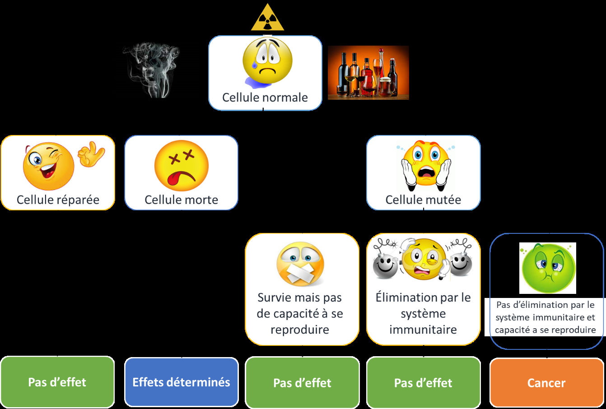
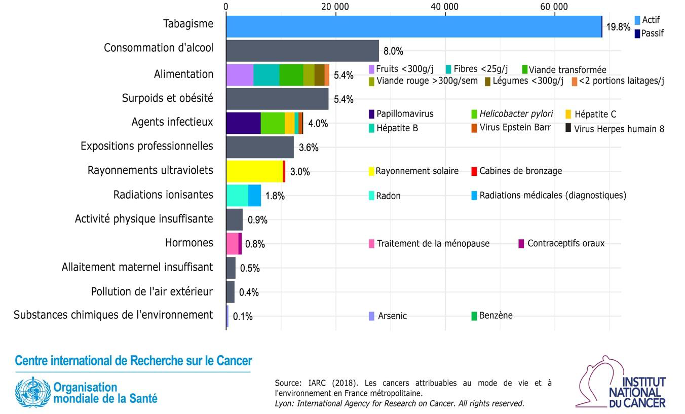

# Cancer

::: warning Chapitre en cours de rédaction
Cette partie est encore un brouillon : certaines sections sont incomplètes.
:::

## Cancer

Le cancer est une maladie qui se
développe lorsque des cellules anormales se multiplient de manière incontrôlée
dans le corps. Ces cellules peuvent former une tumeur qui peut être bénigne
(non cancéreuse) ou maligne (cancéreuse). Les tumeurs malignes peuvent envahir
les tissus environnants et se propager à d'autres parties du corps, ce qui peut
entraîner des complications graves.

Il existe plusieurs facteurs de risque qui peuvent augmenter
les chances de développer un cancer, notamment l'utilisation de certaines
drogues, comme celles qui sont fumées ou l'alcool. La fumée de cigarette, par
exemple, est l'un des principaux facteurs de risque de cancer du poumon et de
cancer de la bouche, du larynx et du pharynx. L'alcool est également un facteur
de risque de cancer de la bouche, du larynx, du sein, du pharynx et du foie.

Nous sommes tous concernés de près ou de loin par le cancer,
sans vraiment comprendre ce que c’est. Cette partie fait le tour des notions à
connaître pour comprendre ce que c’est ainsi qu’une première approche pour
mieux estimer les risques.

### Fonctionnement des cellules

Pour mieux comprendre, commençons par examiner la structure
des cellules. Un organe est composé de tissus constitués de cellules. Chaque
cellule contient un noyau renfermant l'ADN.

[Insérer une image montrant un tissu, une cellule et l'ADN.]

L'ADN agit comme le disque dur et le système d'exploitation
(tels que Windows) de la cellule, déterminant son fonctionnement, comme la
vitesse de reproduction cellulaire.

L'ADN ne peut pas quitter le noyau. Pour cela, des
intermédiaires tels que l'ARN (le même ARN utilisé dans les vaccins contre la
COVID-19) et les protéines sont nécessaires.

Imaginons que l'ADN est un livre de recettes culinaires. Ce
livre contient toutes les instructions requises pour préparer divers plats,
tels que des recettes de pâtes, de gâteaux, etc.

L'ARN (acide ribonucléique) est semblable à un cuisinier qui
lit le livre de recettes et prend en note chaque étape de la préparation. Le
cuisinier ne peut pas préparer le plat seul et a besoin d'aide.

Les protéines représentent les ingrédients nécessaires à la
préparation du plat. Le cuisinier suit les instructions du livre de recettes
pour déterminer quels ingrédients utiliser et comment les assembler. Une fois
les ingrédients prêts, le cuisinier peut commencer à préparer le plat.

Ainsi, l'ADN (le livre de recettes) fournit les instructions
requises, l'ARN (le cuisinier) transmet ces instructions et les protéines (les
ingrédients) sont produites en suivant ces instructions.

#### Approche statistique

<figure class="doc-figure">
  
  <figcaption>Schéma p. 328. Dommage cellulaire, réparation, élimination immunitaire ou évolution possible vers un cancer.</figcaption>
</figure>

L'appréciation du risque de cancer s'avère être compliquée.
Pour illustrer cette complexité, prenons l'exemple de l'alcool. À partir d'une
dose spécifique (environ 5g/l pour une personne sans tolérance) un arrêt
respiratoire peut se produire. Cet effet, que l'on qualifie de déterministe,
est associé à une dose plutôt précise malgré une incertitude lié à chaque
personne. Autrement dit, pour certain effets, on peut associer une dose.

Comme le montre le schéma, un dommage à l'ADN induit par un
agent cancérigène peut potentiellement transformer une cellule en cellule
cancéreuse. Néanmoins, il est crucial de comprendre que cela est fondé sur une
probabilité et non sur une certitude. Autrement dit, une personne peut passer
sa vie à consommer de l'alcool sans jamais développer un cancer, et vice versa.
C'est ce que l'on appelle une approche probabiliste.

Pour donner une image, c’est comme le lancement quotidien
d'un dé à plusieurs centaines de faces. Sur certaines faces, il est écrit «
cancer », sur d'autres, « pas de cancer ». Chaque action qui stimule notre
système immunitaire ou qui active nos mécanismes de réparation de l'ADN, comme
faire de l'exercice, ajoute une face supplémentaire marquée « pas de cancer ».
Inversement, chaque exposition à un agent cancérigène entraîne l'ajout d'une
face marquée « cancer ». Ainsi, chaque jour, le sort est jeté lorsque ce dé à
plusieurs faces est lancé.

Revenir sur les cellules

Expliquer que beaucoup de dégradation de l’adn par seconde
(reprendre effet bio)

Plus il y a de défaut adn plus la probabilité d’avoir la
mauvaise mutation est grande.

#### Cas de la combustion

En théorie, toute combustion ( réaction d’un produit avec de
l’oxygène) devrait produire de l'eau et du CO2. Cependant, en réalité, ce n'est
JAMAIS le cas. La fumée provenant de la combustion du tabac, des barbecues, des
narguilés (shishas), des voitures ou des cheminées contiennent TOUTES des
quantités significatives de substances cancérigènes.

Cela est lié au fait que la chaleur produite par la flamme
va engendrée des réactions chimiques violente conduisant à la formation de
molécule qui ont la capacité de s’intercaler dans l’ADN, de l’attaquer, de
diminuer les défenses du corps etc

Toute substance fumée est cancérigène en raison des composés
chimiques nocifs et des mécanismes impliqués dans le processus de combustion et
d'inhalation de la fumée. Voici quelques raisons pour lesquelles les substances
fumées sont considérées comme cancérigènes :

- Production de composés chimiques nocifs : Lorsqu'une substance
est brûlée, elle produit de nombreux composés chimiques, dont certains sont
cancérigènes, comme les hydrocarbures aromatiques polycycliques (HAP) et les
nitrosamines. Ces composés peuvent endommager l'ADN des cellules, ce qui
augmente le risque de mutations et de développement du cancer.

- Irritation et inflammation des tissus : L'inhalation de la fumée
provoque une irritation et une inflammation des tissus des voies respiratoires,
de la gorge et des poumons. Cette inflammation chronique peut entraîner des
lésions cellulaires et des mutations, ce qui augmente le risque de cancer.

- Formation de radicaux libres : La combustion de substances génère
également des radicaux libres, qui sont des molécules hautement réactives. Les
radicaux libres peuvent endommager les cellules et l'ADN, ce qui peut provoquer
des mutations et augmenter le risque de cancer.

- Diminution de la fonction de nettoyage des voies respiratoires :
Les voies respiratoires sont dotées de mécanismes de nettoyage pour éliminer
les particules et les substances étrangères. Cependant, l'inhalation de fumée
peut altérer cette fonction, permettant aux particules cancérigènes de
s'accumuler et d'endommager les cellules.

S’il
y a combustion il y a risque cancérigène (Cannabis, tabac, etc)

Plusieurs vidéos sur Youtube expliquent que fumer des feuilles
de bananier ou d’autres plante est bon pour la santé ou non cancérigène :
C’est FAUX !

#### Pourquoi le cancer tue ?

En soit des cellules qui se multiplie ça ne tue pas
directement

##### Cancer malin/Benin

Les types les classification

#### Comparaison des risques cancerigène

Il existe de nombreux facteurs de risque de cancer, et il
est complexe de les comparer entre eux car leurs impacts ne sont pas
équivalents. Par exemple, l'inactivité physique peut effectivement augmenter le
risque de cancer, en partie en affectant l'immunité et les enzymes qui
protègent l'ADN contre les espèces réactives de l'oxygène (ROS). Une personne
qui fume pourrait être tentée de penser que son habitude de courir chaque
samedi matin "compense" les effets négatifs de la cigarette. Mais
malheureusement, les choses sont plus complexes.

En outre, tous les cancers ne sont pas évitables. En
d'autres termes, ils ne sont pas tous liés à une exposition à un facteur de
risque spécifique. Selon le Centre International de Recherche sur le Cancer
(CIRC), qui fait partie de l'Organisation Mondiale de la Santé (OMS), environ
40% [[458]](/references#ref-458)
des cancers sont liés à notre mode de vie et à notre environnement. Donc
60% des cancers déclarés seraient « naturels ».

<figure class="doc-figure">
  
  <figcaption>Figure 91. Nombre de nouveaux cas de cancer attribuables au mode de vie et à l'environnement en France en 2015 pour les 30 ans et plus.</figcaption>
</figure>

28% des cancers déclarés, soit plus de la moitié des cancers
évitables, sont liés au tabac et a l’alcool.

Cela permet de se rendre compte du nombre de cacners
déclarés en fonction des facteurs de risques. Mais cela ne permet de dire a
qu’elle point le tabac est plus nocif que la mauvaise alimentation. Prenons
l’hypothèse que le tabac est peu cancérigène mais que tout le monde fume, et
que la mauvaise alimentation est très cancérigène mais que peu de personne sont
concernés. Dans ce cas c’est normal qu’il est y est plue de cancer décalrés
pour le tabav que pour l’alimentation

Pour chercher a comparer la probabilité de développer un
cancer entre deux facteurs il faut regarder les risques relatifs.

<!-- Notes de travail de l'auteur, masquées sur le site :
è Regarder le doc du
CIRC qui détail les RR

– Fiche des
risques génériques—

-

-
-->
